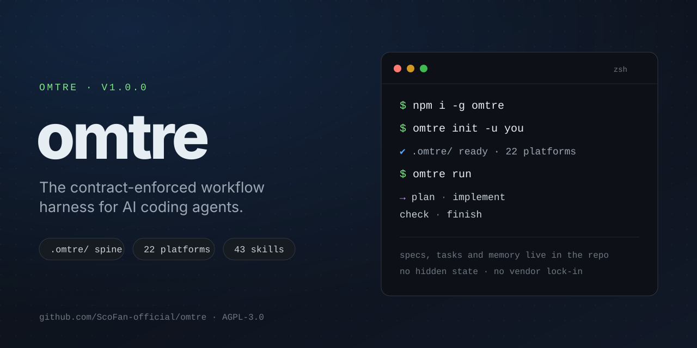
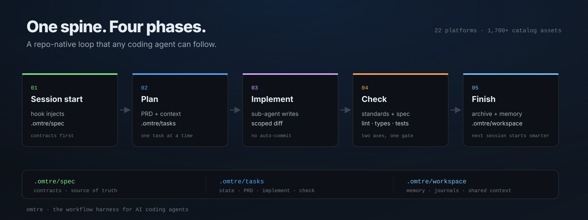

<p align="center">
  
</p>

<h1 align="center">omtre</h1>

<p align="center">
  <strong>The contract-enforced workflow harness for AI coding agents.</strong><br/>
  <sub>One <code>.omtre/</code> spine for specs, tasks, and project memory — across 22 coding agents.</sub>
</p>

<p align="center">
  <a href="https://github.com/ScoFan-official/omtre/releases"></a>
  <a href="https://www.npmjs.com/package/omtre"></a>
  <a href="https://www.npmjs.com/package/omtre"></a>
  <a href="https://github.com/ScoFan-official/omtre/stargazers"></a>
  <a href="./LICENSE"></a>
</p>

<p align="center">
  English · <a href="./README.zh-CN.md">简体中文</a> · <a href="https://scofan-official.github.io/omtre/">Documentation</a> · <a href="./docs/pack.md">Skills &amp; marketplace</a> · <a href="./docs/design.md">Design</a> · <a href="./CHANGELOG.md">Changelog</a>
</p>

> **New to omtre?** Start with the [documentation](https://scofan-official.github.io/omtre/) and complete one real task with the [first-use walkthrough](https://scofan-official.github.io/omtre/start/install-and-first-task.html). The docs state platform differences and known limits explicitly.

## Install

```bash
npm install -g omtre
omtre init -u your-name
```

Prefer a standalone tarball? Install the latest release asset:

```bash
npm i -g https://github.com/ScoFan-official/omtre/releases/download/cli-v1.0.0/omtre-1.0.0.tgz
```

Requirements: **Node.js >= 18.17** and **Python >= 3.9**.

## Why omtre?

AI coding agents are fast, but each new session starts from zero. omtre makes the project itself the source of truth: specs describe how work should be done, tasks carry the context for a change, and journals preserve what happened last time. The agent reads the same contracts your team does.

| Principle | What it means in practice |
| --- | --- |
| **Contracts, not suggestions** | Specs and gates live in `.omtre/spec/`; the workflow refuses to skip them. |
| **One spine, any agent** | The same `.omtre/` layout works across 22 coding agents and IDEs. |
| **Repo-native state** | Tasks, decisions, and memory stay in the repo. No hidden service, no vendor lock-in. |
| **Batteries included** | 43 default skills, a marketplace, and 1,700+ catalog assets. |
| **Independent cadence** | omtre has its own release line and design principles; upstream changes are inputs, not the roadmap. |

## Quick start

```bash
# 1. Initialize the platforms you use
omtre init --claude --cursor --codex -u your-name

# 2. Ask your agent to start a task.
#    The session hook injects the relevant specs and the active task.

# 3. Finish the task when the work is done.
/omt:finish-work
```

For an unattended loop:

```bash
omtre run --until-empty
```

`omtre run` takes the frontier head, implements it in its own worktree, verifies it, and records a run ledger. Delivery is opt-in.

## How it works



1. **Session start** — the hook injects the relevant `.omtre/spec/` contracts and the active task context.
2. **Plan** — the agent turns the request into `prd.md`, `design.md`, and `implement.md` under `.omtre/tasks/`, one question at a time.
3. **Implement** — an `omtre-implement` sub-agent writes the scoped diff. No auto-commit.
4. **Check** — an `omtre-check` sub-agent reviews the diff against standards and the spec, then runs lint, type-check, and tests. Mechanical fixes are allowed; spec findings are report-only.
5. **Finish** — the task is archived, journals are updated, and durable learnings are promoted back into `.omtre/spec/`.

## What lives in `.omtre/`

| Path | Purpose |
| --- | --- |
| `.omtre/spec/` | Team contracts: architecture, conventions, quality gates, domain rules. |
| `.omtre/tasks/` | One directory per change: PRD, design, implementation context, check context. |
| `.omtre/workspace/` | Per-developer journals and shared project memory. |
| `.omtre/agents/` | Role cards for implement, check, research, plan, and orchestration. |
| `.omtre/domains/` | Board protocols for multi-ticket delivery and worklog. |

## Platforms

omtre ships adapters for 22 coding agents and IDEs, including Claude Code, Cursor, Codex, OpenCode, Gemini CLI, GitHub Copilot, Devin, Qoder, CodeBuddy, Kiro, Kilo, Droid, Trae, Grok, Kimi, and Snow. See [supported platforms](./docs/pack.md#platform-support-22) for the full list and per-platform setup.

## Skills & marketplace

- **43 default skills** — including `omtre-run`, `omtre-domains`, `dispatch-roster`, `hygiene-sweep`, `rules-audit`, `code-review`, `tdd`, and the `omtre-meta` guide.
- **1,700+ catalog assets** — vendored with attribution; see the [marketplace](./marketplace/README.md).

Install the recommended skill set:

```bash
npx skills add ScoFan-official/omtre --agent <your-platform> --copy
```

Install the spec contracts:

```bash
omtre init --registry gh:ScoFan-official/omtre/marketplace --template agent-workflow --append
```

<!-- omtre:upstream-attribution:start -->
## Migrating from Trellis

omtre can coexist with Trellis: the CLI is `omtre`/`omt`, the directory is `.omtre/`, and the `trellis` binary is untouched. For an existing Trellis 0.6.x project, `omtre migrate` moves managed files to `.omtre/`, keeps user data, and writes `.backup` copies for modified managed files.
<!-- omtre:upstream-attribution:end -->

```bash
omtre migrate --dry-run
omtre migrate
```

## Temporary ablation

`omtre ablate` temporarily removes all project-owned omtre surfaces after creating a verified recovery transaction outside the project. Start a fresh agent session for the comparison, then `omtre restore` to recover the exact prior state. `--dry-run` previews either operation.

This is different from `omtre uninstall` (permanent removal) and `OMTRE_HOOKS=0` (hooks only). Ablation does not launch agents, manage worktrees, hide Git changes, or remove the global CLI, channel logs, or host transcripts. If a managed path changes while ablated, restore refuses all writes until the conflict is resolved.

## Design

omtre is built around five commitments: contracts over advice, repo-native state, agent-agnostic adapters, a small core with an absorbable edge, and an independent release cadence. Read [the design notes](./docs/design.md) for the longer version.

## Origins & license

<!-- omtre:upstream-attribution:start -->
omtre is an independent project derived from [Trellis](https://github.com/mindfold-ai/trellis). The upstream project and its copyright remain with Mindfold LLC; omtre's modifications are released under the same AGPL-3.0 license. See [NOTICE](./NOTICE) and [upstream notes](./docs/upstream.md) for the lineage and sync policy.
<!-- omtre:upstream-attribution:end -->

## Community

- [Issues](https://github.com/ScoFan-official/omtre/issues)
- [Marketplace](./marketplace/README.md)
- [Contributing](./CONTRIBUTING.md)
- [Changelog](./CHANGELOG.md)
