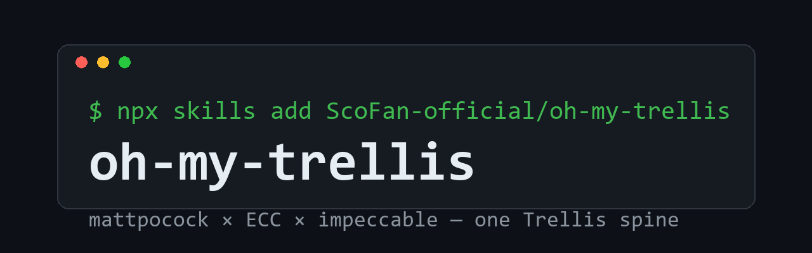

<p align="center">
<picture>
<source srcset="assets/hero.png" media="(prefers-color-scheme: dark)">
<source srcset="assets/hero.png" media="(prefers-color-scheme: light)">

</picture>
</p>

<p align="center">
<strong>开箱即用的 AI 编码工程化框架</strong><br/>
<sub>AI 写代码很快，但它每次会话都从零开始理解项目，记不住你的规范，也记不住团队级别的需求。omtre 会把规范、任务、记忆沉淀进仓库，让任意 Coding Agent 都按你的工程标准来实践。</sub>
</p>

<p align="center">
<a href="./README.md">English</a> •
<a href="./README.zh-CN.md">文档</a> •
<a href="#快速开始">快速开始</a> •
<a href="./README.zh-CN.md#平台支持22-个">支持平台</a> •
<a href="./marketplace/README.md">模板市场</a>
</p>

<p align="center">
<a href="https://github.com/ScoFan-official/omtre/releases"></a>
<a href="https://github.com/mindfold-ai/Trellis/blob/main/LICENSE"></a>
<a href="https://github.com/ScoFan-official/omtre/stargazers"></a>
<a href="https://discord.com/invite/tWcCZ3aRHc"></a>
<a href="https://github.com/mindfold-ai/Trellis/issues"></a>
<a href="https://github.com/mindfold-ai/Trellis/pulls"></a>
<a href="https://deepwiki.com/mindfold-ai/Trellis"></a>
<a href="https://chatgpt.com/?q=Explain+the+project+mindfold-ai/Trellis+on+GitHub"></a>
</p>

<p align="center">

</p>

## 为什么用 omtre？

| 能力 | 带来的改变 |
| --- | --- |
| **自动注入规范** | 将规范沉淀到 `.omtre/spec/` 之后，omtre 会在每次会话中按当前任务自动按需注入相关上下文，无需反复说明。 |
| **任务驱动工作流** | PRD、实现上下文、审查上下文与任务状态统一存放于 `.omtre/tasks/`，AI 开发过程保持结构化、可追溯。 |
| **项目记忆** | `.omtre/workspace/` 中的工作日志（journal）会保留上一次会话的脉络，因此每次新会话都能基于真实上下文开始。 |
| **团队共享标准** | Spec 随仓库一同版本化，个人总结出的规则与流程可以直接成为整个团队的基础设施。 |
| **多平台复用** | 同一套 omtre 结构覆盖 22 个 AI coding 平台，无需为每个工具单独搭建工作流。 |

## 前置要求

- **Node.js** >= 18
- **Python** >= 3.9

## 快速开始

```bash
# 1. 安装 omtre
npm install -g omtre@latest

# 2. 在仓库中初始化
omtre init -u your-name

# 3. 或仅初始化你实际使用的平台
omtre init --cursor --opencode --codex -u your-name
```

查看 [快速开始](#快速开始) 与 [支持平台](./README.zh-CN.md#平台支持22-个) 指南以了解详细配置步骤。

## 如何使用

使用流程非常简单：

1. **用自然语言描述你的需求。**
2. **与 AI 一起头脑风暴**，一次只回答一个问题，直到 PRD 足够清晰，然后开始实现。
3. **交由 AI 自主推进** —— AI 会调用 `omtre-implement` 编写代码，并自动依据 Spec、lint、type-check 与测试进行校验。
4. **当工作完成或会话上下文接近上限时，输入 `/omt:finish-work`**。omtre 会归档任务并更新工作日志。

## 工作原理

omtre 内部运行一个 4 阶段循环，skill 与子代理均由系统自动调用：

1. **Plan（规划）** —— `omtre-brainstorm` 逐题梳理需求并写入 `prd.md`；涉及资料调研的部分派发给 `omtre-research` 子代理处理。阶段产出为一组精选的 Spec 与研究文件，由 `implement.jsonl` / `check.jsonl` 编排。
2. **Implement（实现）** —— `omtre-implement` 子代理依据 PRD 编写代码，所需上下文已按 `implement.jsonl` 自动注入，不会执行 git commit。
3. **Verify（验证）** —— `omtre-check` 子代理基于 diff 对照 Spec 逐项核查，并运行 lint、type-check 与测试，在能力范围内自动修复。
4. **Finish（收尾）** —— 执行最终检查后，`omtre-update-spec` 将本轮新增的认知沉淀回 `.omtre/spec/`，为下一次会话积累上下文。

## 资源

| 需求 | 链接 |
| --- | --- |
| 在仓库中安装 omtre | [快速开始](#快速开始) |
| 了解各平台之间的差异 | [支持平台](./README.zh-CN.md#平台支持22-个) |
| 查看实际使用场景 | [技能包与工作流指南](./README.zh-CN.md) |
| 从 Spec 模板起步 | [Spec 模板市场](./marketplace/README.md) |
| 跟进版本更新 | [更新日志](./CHANGELOG.md) |

## 常见问题

<details>
<summary><strong>omtre 与 <code>CLAUDE.md</code>、<code>AGENTS.md</code>、<code>.cursorrules</code> 有何区别？</strong></summary>

这些文件本身是有用的入口，但容易在长期使用中变得冗长臃肿。omtre 在此之上补充了：作用域明确的 Spec、按任务划分的 PRD、工作流关卡、工作区记忆，以及按平台自动生成的适配文件。

</details>

<details>
<summary><strong>omtre 是否仅支持 Claude Code？</strong></summary>

并非如此。omtre 是项目层基础设施，可在多种 coding agent 与 IDE 中使用。

</details>

<details>
<summary><strong>omtre 适合个人开发者还是团队？</strong></summary>

两者皆可。个人开发者主要受益于记忆机制与可复用的工作流；团队使用收益更大——标准统一、任务边界清晰、上下文可审查，且具备跨平台可移植性。

</details>

<details>
<summary><strong>是否需要手动编写每一个 Spec 文件？</strong></summary>

并不需要。多数团队的做法是先由 AI 基于现有代码生成初稿，再人工收紧关键规则。omtre 的效果取决于是否将高价值规则显式化并纳入版本管理。

</details>

<details>
<summary><strong>团队协作时是否会频繁产生冲突？</strong></summary>

不会。个人工作区的 journal 按开发者独立维护，共享的 Spec 与任务则进入仓库，可以像其他项目产物一样进行评审与改进。

</details>

<details>
<summary><strong>可以临时对比启用与关闭 omtre 的项目表现吗？</strong></summary>

可以。`omtre ablate` 会先在项目外创建并验证恢复事务，然后临时移除
omtre 管理的全部项目级表面。请新开一个 agent 会话进行对比；完成后运行
`omtre restore`，即可精确恢复到消融前的状态。两个命令都支持
`--dry-run` 预览。
私有恢复事务会包含 `.omtre` 中 task、spec 和 workspace 的精确字节，
其中可能有用户编写的敏感文本；事务会保留到恢复完成验证为止。

它不同于永久删除的 `omtre uninstall`，也不同于只关闭 hooks 的
`OMTRE_HOOKS=0`。消融不会启动 agent、管理 worktree、隐藏 Git 变更，
也不会删除全局 CLI、channel 日志或宿主会话记录。如果消融期间某个受管理
路径被修改，恢复会拒绝全部写入，直到冲突被处理。

</details>

## 社区与资源

- [技能包与工作流指南](./README.zh-CN.md)
- [GitHub Issues](https://github.com/mindfold-ai/Trellis/issues)
- [Discord](https://discord.com/invite/tWcCZ3aRHc)
- [模板市场](./marketplace/README.md)

### 联系我们

<p align="center">

&nbsp;&nbsp;&nbsp;&nbsp;

</p>

<p align="center">
<a href="https://github.com/mindfold-ai/Trellis">上游仓库</a> •
<a href="https://github.com/mindfold-ai/Trellis/blob/main/LICENSE">AGPL-3.0 License</a> •
最早由 <a href="https://github.com/mindfold-ai">Mindfold</a> 构建
</p>
