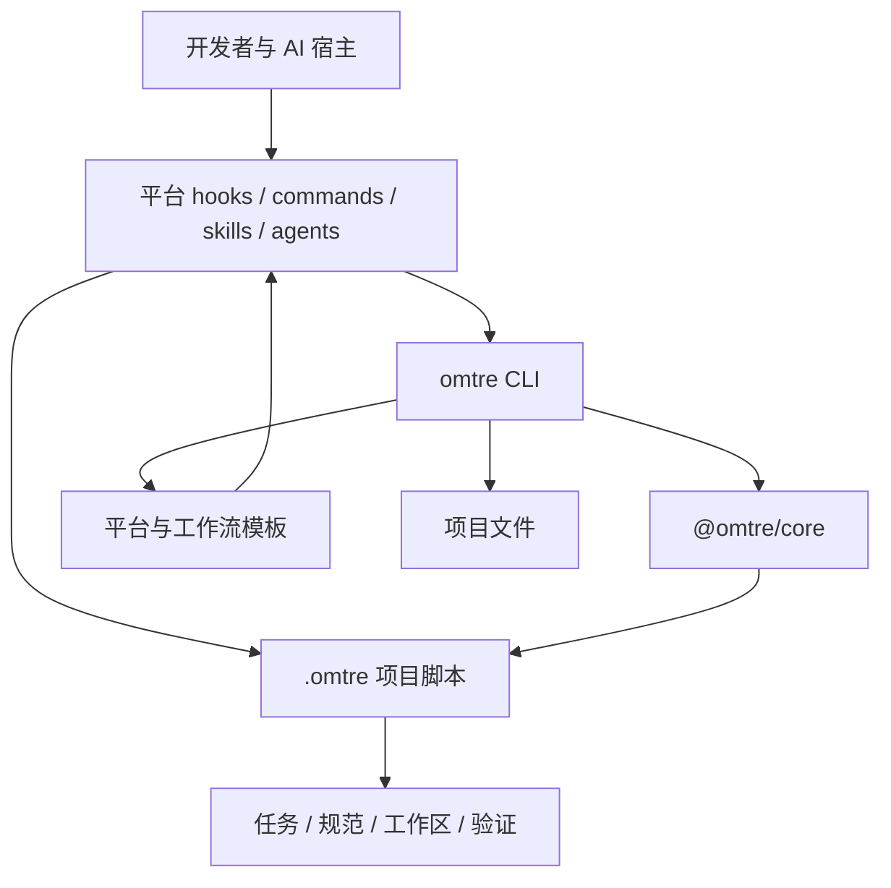
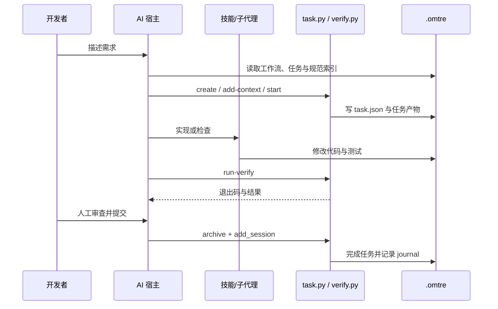

# 架构总览

<MaturityBadge level="mixed" />

omtre 不是模型，也不是托管服务。它由一组安装在本机的 CLI、仓库内脚本、平台适配文件和可审查的 Markdown 状态组成。

## 分层



| 层 | 所在位置 | 责任 |
|---|---|---|
| 用户界面 | 宿主、CLI、命令 | 接收意图并调用工具 |
| 平台适配 | `.claude/`、`.qoder/` 等 | hooks、命令、技能、子代理注册 |
| CLI | 全局 `omtre` / `omt` | 初始化、更新、迁移、运行和通道入口 |
| 核心库 | `@omtre/core` | channel、task、mem 等共享领域原语 |
| 模板 | `packages/cli/src/templates/` | 生成平台文件和项目脚本 |
| 项目脚本 | `.omtre/scripts/` | 任务状态、验证、上下文、日志 |
| 项目状态 | `.omtre/spec/`、`tasks/`、`workspace/` | 仓库内的持久事实 |

## 关键模块

### CLI 与 core

CLI 使用 TypeScript/Node.js 实现，负责：

- 初始化项目与平台文件；
- 更新受管模板；
- 迁移、消融、恢复和卸载；
- 无人值守运行；
- 本机 Channel 运行时。

`@omtre/core` 被捆绑进 CLI tarball，提供 channel、task、mem 等核心类型和运行时原语。普通使用者不需要单独安装它。

### 项目脚本

Python 脚本在初始化时写入项目 `.omtre/scripts/`，之后由 Agent、hooks 和开发者调用：

```text
task.py             任务生命周期
get_context.py      会话上下文与阶段说明
add_session.py      journal 记录
common/task_store.py
common/verify.py
common/config.py
```

这些脚本是项目内可审查、可修改的副本。升级时由 `omtre update` 管理。

### 平台文件

同一份核心状态会映射到不同宿主的原生结构。例如：

| 平台 | hooks | 子代理 |
|---|---|---|
| Claude Code | SessionStart / prompt / pre-tool | hook 注入上下文 |
| Qoder | SessionStart / prompt | pull-based 自读 |
| Codex | prompt / SubagentStart | 需功能开关与信任 |
| Kilo | 无 | 无，inline |

因此“支持某平台”首先表示生成了正确的文件集合，其次才是协议和宿主端行为。

## 一次任务的数据流



### 跨会话耐久化

- 任务产物与状态在 `.omtre/tasks/`；
- 团队规则在 `.omtre/spec/`；
- 会话记忆在 `.omtre/workspace/`；
- 本机会话指针在 `.omtre/.runtime/`；
- 代码事实仍在 Git。

任何“Agent 说自己记得”的机制，都必须能追溯到这些文件或 Git，才算可审查。

## 硬约束与软约束

| 约束 | 实现方式 | 可靠性 |
|---|---|---|
| 验证命令失败阻止归档 | Python 验证脚本 | 机械 |
| 空上下文清单阻止 start | Python 任务脚本 | 机械，仅在文件存在时 |
| 交付分支白名单 | delivery gate | 机械 |
| PRD 包含范围和验收 | 提示词与人工审查 | 软 |
| 只改相关文件 | 角色卡与 Review | 软 |
| 规范必须遵守 | 规范上下文与检查 | 软，除非另有测试/lint |
| 提交前确认 diff | 工作流与人工 | 软 |

设计或决策材料时，不要把软约束写成安全承诺。

## 为什么状态留在仓库

| 仓库内状态 | 托管服务状态 |
|---|---|
| 代码 Review 可看到任务与规范 | 需要在另一个系统同步 |
| Fork 后仍可读取历史 | 依赖服务存续 |
| 可离线使用 | 通常需要网络与账号 |
| 合并冲突需要人工处理 | 中心服务可集中治理 |
| 仓库体积与噪声增加 | 仓库保持轻量 |

omtre 选择前者，因此团队必须接受任务和日志的维护成本。

## 扩展边界

可扩展：

- `.omtre/config.yaml`
- `.omtre/spec/`
- `.omtre/agents/`
- 平台自定义 commands/skills
- 工作流模板
- marketplace spec 模板

1.0.0 没有通用插件 API、云端 Channel 后端、GUI 控制台或统一的 CLI 脚手架。扩展主要落在文件和平台原生能力上。

## 代码位置

维护者可查看：

- CLI 命令：[packages/cli/src/cli](https://github.com/ScoFan-official/omtre/tree/main/packages/cli/src/cli)
- 平台配置：[packages/cli/src/configurators](https://github.com/ScoFan-official/omtre/tree/main/packages/cli/src/configurators)
- 项目脚本模板：[packages/cli/src/templates/omtre/scripts](https://github.com/ScoFan-official/omtre/tree/main/packages/cli/src/templates/omtre/scripts)
- 核心库：[packages/core/src](https://github.com/ScoFan-official/omtre/tree/main/packages/core/src)

## 下一步

- [配置参考](./configuration.md)
- [Hooks](./hooks.md)
- [Channel 多代理协作](./channel.md)
