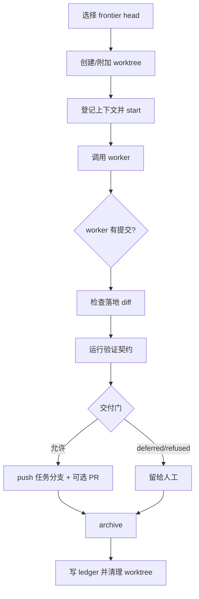

# omtre run 无人值守运行

<MaturityBadge level="advanced" />

`omtre run` 把 frontier 中的任务交给 worker，在独立 Git worktree 中实现和验证，并记录运行 ledger。它是自动化运行器，不是自动发布或自动合并系统。

::: warning 先完成普通会话闭环
真实模型长期无人值守的可靠性仍需要团队试点。不要把首次接触 omtre 或高风险改动交给 `omtre run`。
:::

## 前置条件

任务必须满足：

- 有有效 `task.json`；
- 有任务分支和目标分支；
- 有可运行的验证契约；
- dispatch 能从角色卡或 `worker_default` 解析 worker；
- 项目脚本已提交到任务基线分支；
- provider 在本机可用并有权限。

验证契约缺失时，运行器会把结果视为失败，而不是跳过。

## 检查 frontier

```bash
python3 .omtre/scripts/task.py frontier
```

Frontier 只会给出 blocker 已满足的任务。父子关系不代表顺序，硬依赖应写 `blocked_by`。

## 先 dry-run

```bash
omtre run --ticket .omtre/tasks/<task-dir> --dry-run
omtre run --until-empty --dry-run
```

dry-run 会打印任务和计划动作，不应创建 ledger、worktree 或修改任务状态。

## 运行一个任务

```bash
omtre run --ticket .omtre/tasks/<task-dir> \
  --worker implement \
  --provider codex \
  --timeout 30m
```

`--ticket` 模式可以使用：

- `--worker`
- `--provider`
- `--model`

`--agent` 在 run 中不被接受；派发来自任务 roster、角色卡或 `--worker`。

## 循环运行

```bash
omtre run --until-empty \
  --board orders \
  --max-tickets 5 \
  --max-failures 3
```

| 参数 | 默认 | 说明 |
|---|---|---|
| `--until-empty` | 否 | 持续取 ready ticket；不带时通常只跑一票 |
| `--board` | 无 | 按 `meta.domain` 限制 |
| `--max-tickets` | 5 | 每次运行尝试的任务上限 |
| `--max-failures` | 3 | 同一任务连续失败上限 |
| `--timeout` | 30m | 单 worker 超时 |

loop 模式不接受单票 dispatch overrides；每个任务应从自己的 roster/角色卡解析。

## 内部流程



关键行为：

- worktree 位于 `.omtre/.runtime/worktrees/`；
- 验证失败会产生一次 strike；
- worker 未提交时，运行器可能 stage 非簿记路径；
- 归档前会再次处理验证和交付门；
- 成功或失败后，worktree 通常都会清理；
- 失败的 Channel 日志可能保留用于排查。

## 交付门

交付门不是 CLI flag，而是项目配置和自治模式的组合：

```yaml
autonomy: supervised-delivery

delivery:
  protected_refs:
    - main
    - master
  auto_push_refs:
    - "feature/*"
```

检查顺序通常包括：

1. 当前自治模式是否允许交付；
2. 目标是否为默认分支、tag 或保护 ref；
3. 白名单配置是否合法；
4. 目标 ref 是否匹配白名单。

可能结果：

| 结果 | 行为 |
|---|---|
| `delivery_deferred` | 保留任务分支，等待人工 |
| `push_refused` | 拒绝 push |
| `degraded_no_remote` | 无 remote，不 push，但可能继续归档 |
| allowed | push 任务分支，并可创建 ready PR |

`omtre run` 不会：

- merge PR；
- push 默认分支或 tag；
- 绕过远端分支保护；
- 把一个草稿 PR 自动视为已交付。

PR 存在不等于已合并。

## Ledger

路径：

```text
.omtre/.runtime/runs/run-<UTC>.jsonl
```

常见动作：

- `run_start`
- `attempt_started`
- `ticket_start`
- `worktree`
- `worker`
- `verify`
- `delivery`
- `archived`
- `attempt_finished`
- `ticket_result`
- `blocked`
- `stop`

Ledger 是运行时轨迹，不是对账真源。真实状态优先级仍是：

```text
Git 历史 > worklog > README 进度 > ledger
```

CLI 结束通常会打印 ledger 路径。

## 失败与停止

常见停止原因：

- worker 失败；
- 验证失败；
- 连续失败达到上限；
- dispatch 无法解析；
- frontier 为空；
- 命中 always-stop 路径；
- 内部错误；
- 交付被拒绝。

always-stop 包括 `.omtre/domains/`、`.env`、私钥文件、凭据文件和 secrets 目录等。运行器应该停下，而不是继续修改这些区域。

超过连续失败上限时，任务可能被标记为需要人工处理。

## 真实可靠性

当前测试覆盖了真实任务脚本、Git worktree 和 ledger，但完整运行测试中的 worker 往往是模拟替身，而不是真实 provider。

因此上线前应做：

- 使用真实 provider 的小任务端到端测试；
- worker 超时和中断恢复；
- 验证失败和重试演练；
- 交付门拒绝测试；
- 无 remote、网络失败和权限失败；
- 检查 ledger 与 Git/任务状态是否一致；
- 人审多个自动生成 diff 的质量。

## 团队试点建议

1. 只选低风险任务；
2. 先 `--ticket`，不先 `--until-empty`；
3. 保持 `auto_push_refs` 为空；
4. 人工检查所有 diff；
5. 记录每类停止原因；
6. 至少完成一条真实 provider 恢复演练；
7. 再考虑 supervised delivery。

## 不在当前范围

- 并行运行多个 ticket；
- 自动合并 PR；
- 云端 worker 调度；
- 对任意 provider 无差别支持；
- 自动判断需求正确性；
- 替代 CI 或生产发布系统。

## 下一步

- [质量检查与提交](../guide/quality-and-commit.md)
- [Channel 多代理协作](./channel.md)
- [故障排查](./troubleshooting.md)
