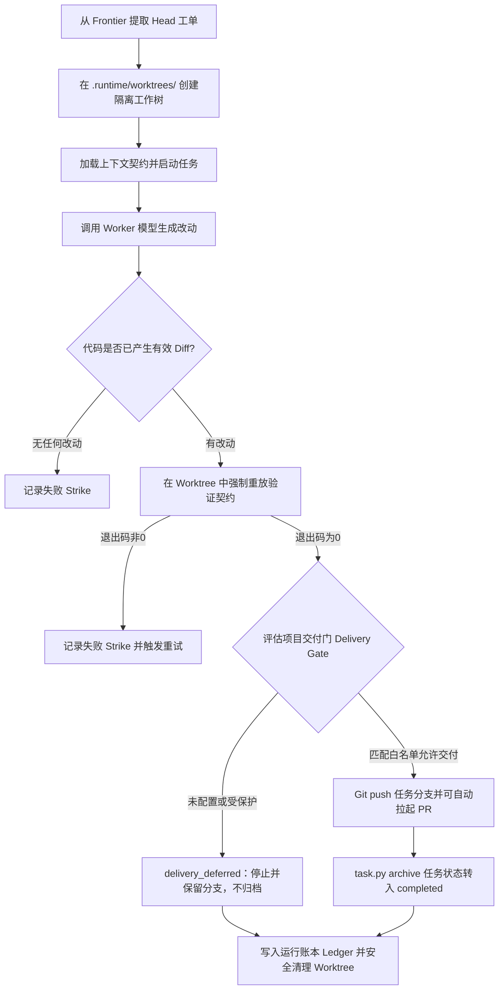

# omtre run 无人值守运行

<MaturityBadge level="advanced" />

`omtre run` 是面向确定性任务批处理的自动化运行器。它从拓扑就绪的任务池（Frontier）中按依赖顺序提取工单，在独立的 Git Worktree 中派发 Worker 进行编码实现，并在本地沙箱中强制重放验证契约，最后将执行轨迹完整记录于运行账本（Ledger）中。

::: danger 架构清醒：自动化批处理执行器，绝非全自动盲推上线系统
`omtre run` 的核心价值在于将低风险、强契约、单测完备的批量工单交由模型自动化尝试。**系统绝对不会自动合并 Pull Request，也绝对不会向 `main`/`master` 或生产保护分支直接推送代码。** 生产交付的终审权必须始终掌握在人类工程师的 PR Code Review 与 CI 门禁手中。
:::

## 运行准入前置条件

一个任务能够被 `omtre run` 消费，需要满足以下运行条件：
1. **任务记录有效**：`.omtre/tasks/<task-dir>/task.json` 可读，且任务尚未完成或归档；运行器不会额外要求状态必须停在 `planning`；
2. **分支契约明确**：已通过 `set-branch` 指定任务分支，且 `base_branch` 目标基线分支合法；
3. **强制绑定验证契约**：任务必须登记有至少一条非交互的验证命令（如 `pnpm test`）。**无验证契约的任务在运行器中直接判负报错，绝不放行**；
4. **角色卡解析成功**：能根据任务的 `roster` 或配置的 `worker_default` 在 `.omtre/agents/` 中定位到有效角色卡；
5. **宿主执行器就绪**：指定的 Provider（如 Codex、Claude）在当前机器具有有效凭据与执行权限。

## 检查就绪任务池（Frontier）

在启动运行器前，先查询当前有哪些任务满足前置依赖、处于 Ready 可执行状态：

```bash
python3 .omtre/scripts/task.py frontier
```

Frontier 仅返回所有硬性依赖（`blocked_by`）已全部归档完成的任务。普通的任务树父子关系不代表执行先后顺序，若存在时序依赖，必须显式声明 `blocked_by`。

## 严格执行 Dry-run 预检

在实际唤起大模型消耗 Token 之前，始终先进行无副作用的计划预览：

```bash
# 针对单张工单进行预检
omtre run --ticket .omtre/tasks/<task-dir> --dry-run

# 针对整个待执行任务池进行批量预检
omtre run --until-empty --dry-run
```

`--dry-run` 仅输出调度决策路径与预计创建的工作树拓扑，**绝不创建 Git worktree，绝不调用模型 API，绝不修改任务状态，绝不写入运行账本**。

## 运行模式与常用参数

### 1. 单工单定向执行（--ticket 模式）

```bash
omtre run --ticket .omtre/tasks/10-26-order-filter \
  --worker implement \
  --provider codex \
  --timeout 30m
```

在单工单模式下，支持显式传入 `--worker`、`--provider` 与 `--model` 覆盖任务默认设置。

### 2. 连续批处理循环（--until-empty 模式）

```bash
omtre run --until-empty \
  --board orders \
  --max-tickets 5 \
  --max-failures 3 \
  --timeout 30m
```

| 参数 | 默认值 | 工程防护意义 |
|---|---|---|
| `--until-empty` | 关闭（默认单次） | 持续从 Frontier 中提取就绪工单，直到队列为空 |
| `--board` | 全部 | 严格限制仅消费特定领域 Board（匹配 `meta.domain`）的任务 |
| `--max-tickets` | 5 | 单次批处理运行的最大任务数上限，防止模型持续消耗资源 |
| `--max-failures` | 3 | 单个任务允许失败重试的最大次数（Strike 上限），达标后自动挂起人工介入 |
| `--timeout` | 30m | 单次 Worker 运行的最大超时硬上限，超时由本地进程强行杀灭 |

::: warning 循环模式禁止参数覆盖
批处理循环模式（`--until-empty`）不接受命令行单票参数覆盖，每张工单的执行器与模型必须完全从自身角色卡或项目配置中解耦解析。
:::

## 运行器核心闭环状态机



核心物理机制：
- **物理工作区隔离**：每个任务在 `.omtre/.runtime/worktrees/<task>/` 建立独立 Worktree，互不影响当前主仓库的工作树状态；
- **机器退出码判据**：代码编写完成后，运行器在 Worktree 内独立子进程中执行绑定的 `run-verify`。任何非 0 退出码均直接判定本轮尝试失败；
- **始终安全清理**：无论任务成功通过还是异常中断，运行器在退出时均会安全卸载并清理 Worktree，杜绝在磁盘残留大量僵尸工作树。

## 交付门（Delivery Gate）机制与安全策略

运行器在完成代码验证与归档后，绝不默认推送代码。是否允许向远端发起 Git push 由 `.omtre/config.yaml` 严格控制：

```yaml
autonomy: supervised-delivery

delivery:
  protected_refs:
    - main
    - master
    - "release/*"
  auto_push_refs:
    - "feature/*"
    - "fix/*"
```

交付门判定状态机：

| 交付决策结果 | 系统行为与工程事实 |
|---|---|
| `allowed` | 目标分支严格命中 `auto_push_refs` 且非受保护分支，向远端推送任务分支；远端是 GitHub 且 `gh` 可用时创建 ready PR |
| `delivery_deferred` | 目标分支不在白名单内。**保留本地任务分支与提交，停止本次运行且不归档任务，留待人工处理** |
| `push_refused` | 目标分支命中了 `protected_refs`（如主干分支），阻断本次运行发起的推送 |
| `degraded_no_remote` | 本地 Git 仓库未配置任何 remote 远端源，自动跳过推送，仅保留本地归档 |

PR 创建发生在 push 成功之后。如果 `gh` 不可用、未登录或远端不是 GitHub，任务可能已经 push 但 PR 创建失败，运行会停在 `pr_open_failed` 且不归档；这时需要人工创建 PR。

**核心红线**：
- `omtre run` 绝对不会执行 `git merge`；
- 绝对不会向默认分支（如 `main`）或 Git Tag 直接推送提交；
- 远端分支保护（Branch Protection Rules）与审查权限始终由托管平台强制保障。

## 运行审计账本（Run Ledger）

运行器在每次执行时，均会在本地生成高精度的只追加（Append-only）审计日志流：

```text
.omtre/.runtime/runs/run-<UTC-TIMESTAMP>.jsonl
```

账本详细记录工单提取、Worktree 挂载、Worker 交互耗时、验证命令输出退出码及最终交付判定。在排查批处理中断时，首要查看终端打印出的对应 Ledger 路径。

## 敏感路径与熔断保护（Always-stop）

当运行器检测到模型尝试修改以下敏感路径时，系统会立即触发最高级别安全熔断，强制终止当前工单：
- `.omtre/domains/`（领域协议与全局路由定义）；
- `.env*`、`*.pem`、`*.key`、`id_rsa*`（任何环境变量、密钥与私钥文件）；
- 涉及凭证与证书的核心安全目录。

熔断会立即停止当前任务线，但 `always_stop` 本身只影响本次运行，不会改动 `task.json`。只有连续失败达到阈值或派发被拒绝时，运行器才会给任务写入 `triage=ready-for-human`，等待人工处理。
- 无 remote、网络失败和权限失败；
- 检查 ledger 与 Git/任务状态是否一致；
- 人审多个自动生成 diff 的质量。

## 团队试点建议

1. 只选低风险任务；
2. 先 `--ticket`，不先 `--until-empty`；
3. 保持 `auto_push_refs` 为空；
4. 人工检查所有 diff；
5. 记录每类停止原因；
6. 至少完成一条真实 provider 恢复演练；
7. 再考虑 supervised delivery。

## 不在当前范围

- 并行运行多个 ticket；
- 自动合并 PR；
- 云端 worker 调度；
- 对任意 provider 无差别支持；
- 自动判断需求正确性；
- 替代 CI 或生产发布系统。

## 下一步

- [质量检查与提交](../guide/quality-and-commit.md)
- [Channel 多代理协作](./channel.md)
- [故障排查](./troubleshooting.md)
