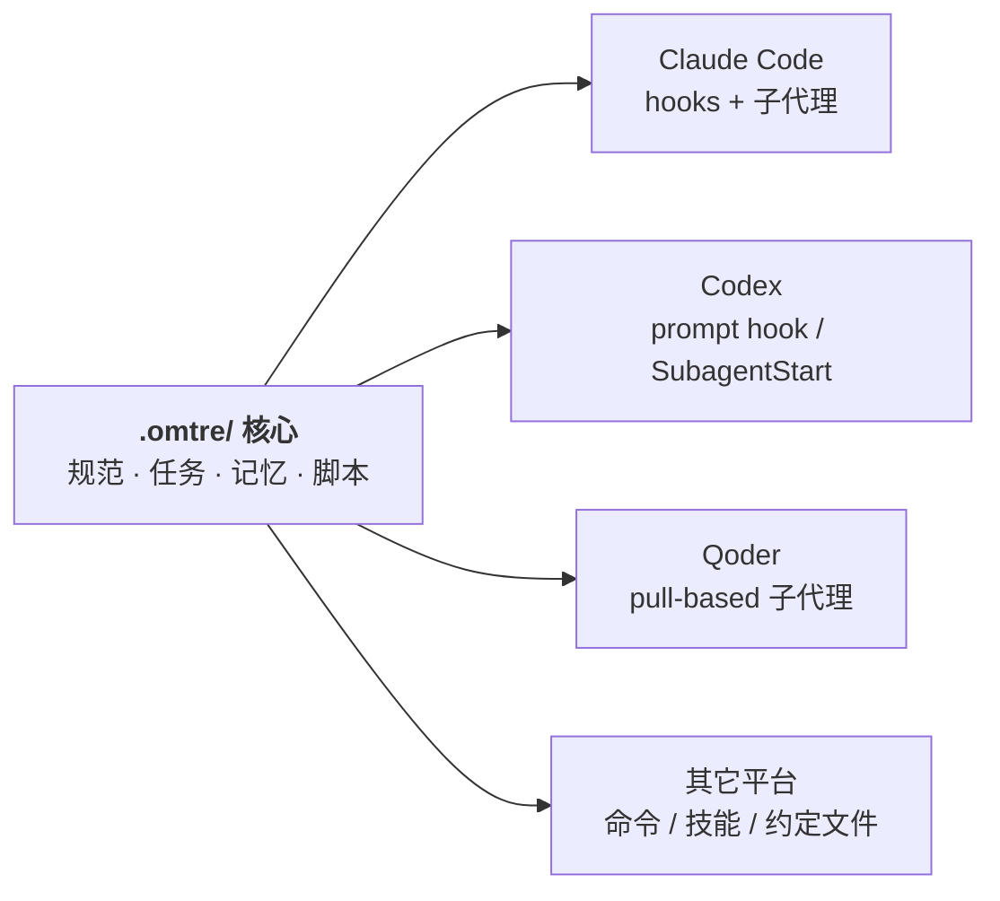

# 多平台接入

<MaturityBadge level="mixed" />

omtre 通过统一的 `.omtre/` 主轴承载团队规范、任务生命周期与项目记忆，并向各 AI 编码宿主输出适配文件。然而，不同宿主对环境 Hooks、Slash Commands、技能扩展（Skills）与进程级子代理（Sub-agents）的原生支持程度存在巨大差异。

在团队中推行时，必须从实际使用的 1–2 个核心宿主切入，验证端到端闭环后方可横向扩展。**切勿将“CLI 能够生成该平台配置文件”等同于“该平台已在当前宿主版本上完成端到端黑盒验证”。**



图示的是文件交付通道，不代表各宿主的运行时能力相同；具体深度以下方矩阵为准。

## 平台支持与核心适配通道

| 平台 | 初始化标志 | 核心配置目录 | 宿主交互通道与架构深度 | 生产接入建议 |
|---|---|---|---|---|
| **Claude Code** | `--claude` | `.claude/` | 支持 SessionStart 等原生 hooks、子代理与自定义斜杠命令 | 首选主力平台，机制最完整；注意项目需配置受信任 |
| **Codex** | `--codex` | `.codex/`、`.agents/skills/` | 基于 Prompt Hook / SubagentStart 派发；内联技能共享 | 检查 hooks 功能开关，注意安全沙箱提示 |
| **Qoder** | `--qoder` | `.qoder/` | Pull-based 子代理架构；角色卡驱动按需读取 JSONL 清单 | 推荐平台；上下文隔离强，适合复杂任务 |
| **Cursor** | `--cursor` | `.cursor/` | 扁平规则、命令与 hooks 适配 | 注意宿主各小版本对 hooks 的实现变更，升级后需复验 |
| **GitHub Copilot** | `--copilot` | `.github/` | 静态 Prompt、Agent 与 Hooks 文件适配 | 模型对 SessionStart 的实际可见性需实测，勿盲信注入 |
| **OpenCode** | `--opencode` | `.opencode/` | 基于 JS 插件拦截提供会话启动与轮次上下文 | 验证插件环境运行时权限与稳定性 |
| **Gemini CLI** | `--gemini` | `.gemini/`、`.agents/skills/` | Pull-based 角色卡与子代理拉取机制 | 适合命令行纯文本交互流 |
| **Kiro** | `--kiro` | `.kiro/` | Agent hooks 与平台技能规范定义 | 适用于支持对应规范的专用环境 |

完整 22 个平台的具体路径、协议适配深度与测试状态见[平台支持矩阵](../reference/platform-matrix.md)。

## 初始化与配置管理

仅为团队实际使用的平台生成配置，避免在仓库内引入多余的未用模板：

::: code-group

```bash [单平台接入]
# 仅生成 Qoder 平台配置与个人工作区
omtre init -u <your-name> --qoder
```

```bash [多平台组合]
# 同时为团队中的 Claude Code 与 Codex 用户生成对应平台入口
omtre init -u <your-name> --claude --codex
```

```bash [存量项目增补平台]
# 在已有 .omtre/ 的项目中增补 Cursor 适配，无需重复传 -u
omtre init --cursor
```

:::

检查当前仓库已启用并识别的平台清单：

```bash
omtre platforms
omtre platforms --json
```

若当前 checkout 缺失 `.omtre/.developer` 凭据文件，`init` 会基于当前仓库受管状态建立个人工作区，并可生成入组引导任务（Joiner onboarding）。

## 平台的四层真实成熟度

在技术评审与团队选型时，必须根据以下四层客观标准进行评估，不可轻信泛化的支持宣传：

```text
┌────────────────────────────────────────────────────────┐
│ 第 4 层: 生产长期验证 (真实业务仓库长期平稳运行)        │
├────────────────────────────────────────────────────────┤
│ 第 3 层: 宿主端黑盒实测 (在具体 IDE/CLI 版本完成闭环)   │
├────────────────────────────────────────────────────────┤
│ 第 2 层: 协议与模板就绪 (生成 hooks/commands/agents)   │
├────────────────────────────────────────────────────────┤
│ 第 1 层: 文件生成幂等 (CLI 单元测试保证生成路径正确)    │
└────────────────────────────────────────────────────────┘
```

1. **第 1 层：文件生成幂等**：CLI 具备自动化测试，保证能正确在对应目录下创建文件，且多次运行不发生覆写损坏；
2. **第 2 层：协议与模板就绪**：针对该平台编写了对应的语法模板（如 `.claude/commands/*.md` 或 `.qoder/rules/*.md`）；
3. **第 3 层：宿主端黑盒实测**：工程师在特定宿主二进制版本中完整走通“创建任务 -> 注入规范 -> 修改测试 -> 退出码重放 -> 任务归档”完整链路；
4. **第 4 层：生产长期验证**：团队在核心工程项目中跨版本稳定落地。

**作者建议**：团队评估时，必须在宿主中实际达到第 3 层要求方可落地。对于文档标注为 `convention` 或 `partial` 的边缘平台，一律视为草稿模板（Draft），必须先在练习仓库中进行可用性实测。

## 平台底层机制详解

### Claude Code
初始化写入 `.claude/settings.json`、命令与技能。启动 Claude Code 时，宿主必须通过信任授权，Hook 才能正常触发执行。企业内网或特殊安全策略若禁用了 Hook 执行，会导致自动注入静默失效。

### Qoder
Qoder 采用拉取式（Pull-based）子代理模型。omtre 生成的角色卡指导 Worker 进程自行调用终端工具读取当前活跃任务与 `implement.jsonl`，实现物理层面的上下文隔离，不占用主会话窗口。

### Codex
依赖 Prompt Hook 与 SubagentStart 派发机制，在 `.agents/skills/` 维护共享技能目录。若宿主未放开 Hook 权限，需引导 Agent 主动读取 `.omtre/workflow.md`。

### Cursor
初始化扁平结构。需注意 Cursor 处于高频迭代期，不同版本对 rules 与 hooks 的解析逻辑偶有变动。宿主升级后必须重新检验 SessionStart 注入是否生效。

### GitHub Copilot
生成 `.github/` 下的提示词与代理文件。由于 Copilot 在部分 IDE 插件宿主中对外部输出的可见性存在裁剪，必须通过打印调试确认启动上下文是否切实进入了大模型窗口。

## 环境变量与排障逃生口

当怀疑 Hook 脚本运行异常、阻塞终端启动或造成卡死时，使用环境变量临时阻断：

```bash
# 临时禁用所有 omtre hooks 自动化注入
export OMTRE_HOOKS=0
```

关闭 Hook 后，`.omtre/` 目录结构与规范文件依然完整，但上下文自动注入将停止。此时可要求 Agent 手动读取目标规范或直接在命令行执行 `task.py`。

只读核验平台目录结构，严禁使用盲目批量删除命令：

```bash
find .qoder -maxdepth 3 -type f | sort
find .claude -maxdepth 3 -type f | sort
```

## 跨平台协作架构

不同团队成员使用不同编辑器时，所有平台配置共享唯一的仓库核心：

```text
.omtre/                         # 唯一团队共享核心
├── spec/                       # 架构规范与质量契约
├── tasks/                      # 活动任务与归档证据
├── workspace/                  # 开发者个人隔离日志
└── scripts/                    # 验证与状态流转原生脚本

.claude/                        # 平台薄适配层（供 Claude Code 读取）
.qoder/                         # 平台薄适配层（供 Qoder 读取）
.cursor/                        # 平台薄适配层（供 Cursor 读取）
.codex/                         # 平台薄适配层（供 Codex 读取）
```

- **任务状态与规范同源**：无论何种平台派发的 Agent，查阅的均是同一份 `task.json` 与 `.omtre/spec/`；
- **通道机制各异**：不同宿主派发子代理、调用工具命令的格式完全由各平台独立映射承载。

## 平台清理与卸载原则

严禁直接通过 `rm -rf` 手工删除平台目录，多宿主配置文件之间存在符号链接或共享依赖，暴力删除极易造成半残留损坏。

- **仅临时停用对比效果**：使用 [omtre ablate / restore](../advanced/ablate-and-restore.md) 创建外部快照；
- **永久彻底清理所有受管文件**：
  ```bash
  omtre uninstall --dry-run
  omtre uninstall
  ```

## 下一步

- [平台支持矩阵](../reference/platform-matrix.md)
- [升级、回滚与卸载](./upgrade-and-remove.md)
- [Hooks](../advanced/hooks.md)
