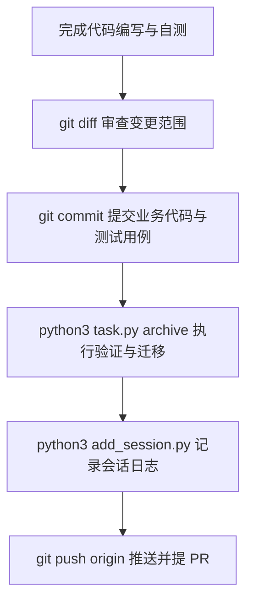

# 质量检查与提交

<MaturityBadge level="mixed" />

大语言模型给出的“代码已全部通过检查”是一句缺乏刚性保证的文本描述。omtre 建立分层质量证据链，将基于规则的审查、确定性的本地进程执行验证与人工 Review 严格解耦，以机器可复现的退出码（Exit Code）作为工作交付的核心底线。

## 质量验证的四个层级

| 层级 | 检验对象 | 证据形式 | 判定与执行主体 | 机械阻断能力 |
|---|---|---|---|---|
| 规范审查（Standards） | 架构与编码风格约定 | 静态规则命中报告 | 静态扫描器、Reviewer 子代理 | 弱（提示/建议） |
| 任务符合性（Spec） | PRD 范围与验收标准对齐 | 功能与边界检查清单 | 检查子代理、工程师自测 | 中（人工比对） |
| 本地验证契约（Contract） | 测试、构建与类型系统 | 独立子进程退出码 | Python 子进程隔离执行 | **有契约且未跳过时阻断** |
| 交付准入（Delivery） | 集成风险与安全合规 | CI 流水线状态、PR 评审 | GitHub/GitLab CI、评审工程师 | **分支合并硬阻断** |

## 本地验证契约（Verification Contract）的技术刚性

验证契约是固化在 `task.json` 内的自动化命令清单，代表该任务被视为“完成”必须满足的可复现机器判据。

```json
{
  "verify": [
    {"cmd": "pnpm lint", "expect_exit": 0, "timeout": 300},
    {"cmd": "pnpm test:unit", "expect_exit": 0, "timeout": 600}
  ]
}
```

### 命令契约的技术红线

登记进入验证契约的命令必须满足以下执行要求：

1. **单次非交互执行**：严禁携带 `--watch`、热更新或任何等待用户按键输入的标志。命令必须能够在非 TTY 管道环境中自主完成并退出。
2. **退出码确定性**：程序必须以显式退出码结束，默认期望退出码为 `0`。任何未捕获异常、测试失败或语法错误必须产生非零返回码。
3. **独立进程组与超时强杀**：omtre 底层通过独立的会话组（Process Session）拉起子进程执行命令。一旦命令超出 `timeout` 时限，系统将递归查杀整个进程树（Process Tree），杜绝由于孤儿守护进程常驻而造成管道挂起或自动化循环死锁。

### 契约的注册与执行

```bash
# 为指定任务追加验证命令
python3 .omtre/scripts/task.py add-verify \
  .omtre/tasks/<task-dir> \
  "pnpm test:unit" \
  --timeout 600

# 立即在本地执行验证契约以观察退出码
python3 .omtre/scripts/task.py run-verify .omtre/tasks/<task-dir>

# 清除所有已登记命令
python3 .omtre/scripts/task.py clear-verify .omtre/tasks/<task-dir>
```

### 归档时的验证重放

在调用 `task.py archive` 归档任务时，系统**绝不相信**历史缓存的“上次测试成功”标志，而是在当前工作树就地完整重放所有验证契约命令：

- **任一命令退出码与预期不符**：归档中断，任务目录保持原地不动，状态维持在 `in_progress`。
- **配置强制约束**：若 `.omtre/config.yaml` 开启了 `verify_required: true`，未登记任何验证命令的任务在尝试归档时将被直接拒绝；未开启时，缺少契约通常只给出警告。
- **显式绕过约束**：`--skip-verify "<reason>"` 会在重放前直接放行并写入 `verify_skipped`。原因必须具备审计价值，不能把跳过当作常规路径。

## 代码提交与任务归档的核心界限

明确区分“业务代码提交”与“任务目录归档”是保障 Git 历史整洁与可追溯性的根本防线。

### 职责边界对照

| 操作环节 | 驱动命令 | 涉及文件范围 | 责任主体与语义 |
|---|---|---|---|
| 业务代码提交 | `git commit` | `src/**`, `tests/**`, `package.json` 等 | **工程师显式负责**。表达功能的业务逻辑增删与重构。 |
| 任务状态归档 | `task.py archive` | `.omtre/tasks/<slug>` 迁移至 `.omtre/tasks/archive/...` | **工具链自动化执行**。仅负责任务状态、目录迁移与任务簿记提交；不提交业务代码。 |
| 代码远端推送 | `git push` | 当前工作分支的所有本地提交 | **工程师显式负责**。将分支提交推送到代码托管平台。 |

### 核心铁律

1. **归档绝不替代业务代码提交**：在执行 `task.py archive` 之前，所有业务代码及新增测试用例必须已经通过 `git commit` 显式提交。严禁将未暂存或未提交的业务代码与任务元数据混在一起归档。
2. **归档绝不会执行 `git push`**：`task.py archive` 的影响范围严格限制在本地文件系统与本地 Git 仓库，绝不会擅自向远程仓库发起任何网络推送（Push）。推送时机与 PR 创建流程完全交由工程师自主把控。

### 标准交付时序



## 提交前的自审清单

在敲下 `git commit` 之前，按以下命令核对工作区：

```bash
# 查看改动文件列表，确保无无关脏文件或临时产物
git status --short

# 审查具体代码差异，确认无调试断点或硬编码凭据
git diff --cached
git diff

# 本地复核验证契约是否全绿
python3 .omtre/scripts/task.py run-verify .omtre/tasks/<task-dir>
```

提交原则：
- 一次提交只做一件逻辑完整的事。
- 严禁使用 `git commit -a` 或无脑 `git add -A` 打包未审查的文件。
- 绝不提交本地环境密钥、临时构建缓存或 IDE 专有配置。

## 下一步

- [任务与 PRD](./tasks.md)：了解任务状态流转与目录组织结构。
- [工作区与开发者记忆](./workspace-memory.md)：掌握任务归档后会话日志（Journal）的写入方式。
- [多平台接入](./platforms.md)：了解在不同 Agent 宿主环境中两轴审查的触发方式。
- [无人值守执行](../advanced/unattended-run.md)：查看自动化任务调度中验证契约的执行策略。
