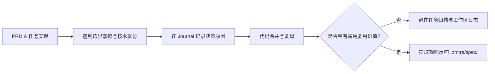

# 规范系统

<MaturityBadge level="mixed" />

规范（spec）是固化在仓库内的确定性工程约束与架构契约，存放于 `.omtre/spec/` 目录中。它与业务代码处于同一版本控制生命周期内，随 Git 提交、评审并持续演变。

规范的存在不是为了堆砌泛泛而谈的编程教条，而是作为 Agent 在编码和审查时的高信噪比上下文，以及人类工程师在 Code Review 中评估代码变更合规性的同源事实。

## 规范在仓库中的定位与检索机制

规范体系采用目录分层与入口索引机制组织：

```text
.omtre/spec/
├── index.md           # 全局规范导航与领域入口
├── guides/            # 跨领域的工程实施指引
│   └── index.md
├── backend/           # 后端领域规范
│   ├── index.md       # 后端规范索引
│   ├── api.md         # API 契约与错误码
│   ├── db.md          # 数据库与迁移规则
│   └── testing.md     # 后端测试规范
└── frontend/          # 前端领域规范
    ├── index.md       # 前端规范索引
    ├── components.md  # 组件封装规范
    └── state.md       # 状态管理模式
```

### 分层索引与按需加载

在上下文窗口有限的大模型工程实践中，严禁在初始阶段将整个 `.omtre/spec/` 目录全量灌入 Agent 上下文。omtre 采用两阶段检索与按需加载：

1. **顶级索引发现（Index Discovery）**：Agent 在启动时仅读取各子目录的 `index.md`，获取领域规则的元数据纲要与定位路径。
2. **上下文清单绑定（Curated Injection）**：在具体任务的规划期（Planning），通过 `implement.jsonl` 或 `check.jsonl`，将与当前变更直接相关的 1~3 篇具体规范显式注入到执行子代理与审查子代理的提示词中：

```bash
python3 .omtre/scripts/task.py add-context \
  .omtre/tasks/<task-dir> \
  implement \
  ".omtre/spec/backend/api.md" \
  "API 响应结构与异常捕获标准"
```

这种机制确保子代理在实现与检查时，只携带高密度的相关规则，既不遗漏核心约束，又不会因无关长文本稀释注意力。

## 作为 Code Review 的同源事实

规范的核心价值在于提供可验证、无争议的审查依据。在工程落地中，它承担双向同源对齐的角色：

### 1. 消除审查意见的主观争论

当 Code Review 提出修改意见时，应当能够直接映射到 `.omtre/spec/` 中的具体段落与版本。若某条修改建议无法在既有规范中找到依据，说明该要求要么是审阅者的个人偏好，要么是尚未被团队沉淀为共识的新规则——此时应先发起规范补全，而非直接阻塞业务 PR。

### 2. 审查子代理与人类审查者基线统一

审查阶段的子代理通过 `check.jsonl` 获取同样的规范基准进行自动化初审（Check/Review）。人类工程师复核时无需再次检查琐碎的机械性格式或通用错误处理，重点聚焦业务逻辑与整体系统设计。

| 规范约束类型 | 典型代表 | 查验手段 |
|---|---|---|
| 机械约束（Mechanical） | 字段命名风格、依赖导入顺序、文件目录归属 | Linter、静态分析、验证脚本阻断 |
| 契约约束（Contractual） | 统一错误返回结构、敏感数据脱敏、幂等性要求 | 单元测试、集成测试、审查子代理核验 |
| 架构仲裁（Architectural） | 模块依赖方向、读写分离模式、边界调用封装 | 架构设计文档、人类 Code Review 确认 |

## 经验沉淀的最佳路径：从 Journal/PRD 反哺 Spec

高价值的规范永远脱胎于真实的工程实践与事故排查，而非凭空手写大而全的规章制度。

### 反哺闭环流程



1. **现场记录（Journal）**：在任务执行过程中，开发者在 `.omtre/workspace/<name>/journal-N.md` 中记录踩坑原因、框架缺陷或第三方 API 的非预期行为。
2. **提炼共识**：任务归档或上线复盘时，识别出“未来任何开发者或 Agent 遇到同类场景都会踩坑”的通用规则。
3. **沉淀入库**：将经过验证的解决方案精简成一条规范，补充测试验证用例与正反代码范例，提交至 `.omtre/spec/`。

### 严禁凭空构想教条

不要在项目初期试图编写“完美的微服务设计哲学”或“优雅代码全集”。未能引用仓库内真实文件路径、未能配套具体自动化验证手段的规则，一律不应进入规范库。

## 一条可执行规范的最小完备结构

一条合格的规范必须让 Agent 和工程师都能明确判断“当前代码是否违规”：

```markdown
# Backend API Error Handling

## 触发条件与适用范围
所有位于 `src/controllers/**/*.ts` 的 HTTP 请求入口及路由处理函数。

## 强制要求
1. 控制器内部严禁直接透传原始数据库异常或第三方 HTTP 客户端异常。
2. 异常必须转换为继承自 `AppError` 的强类型业务错误，并携带明确错误代码。
3. 严禁使用字符串拼接方式组装错误消息。

## 规则动因
生产环境中历史偶发将包含 SQL 语句与字段名的底层异常暴露给前端，造成安全合规漏洞并导致调用端无法依据错误码精准降级。

## 代码范例

### Bad
```ts
try {
  await db.insert(user);
} catch (e) {
  res.status(500).json({ error: e.message });
}
```

### Good
```ts
try {
  await db.insert(user);
} catch (e) {
  logger.error("User registration failed", { error: e });
  throw new BusinessException(ErrorCode.USER_CREATION_FAILED, "用户创建失败");
}
```

## 验证与验收
- 单元测试中包含异常捕获与状态码断言。
- 自动化运行 `pnpm test:controller` 必须通过。
```

## 规范治理与定期瘦身

规范具有生命周期。过时和冗余的规范比没有规范危害更大，会直接导致 Agent 上下文污染并给出过时方案。

- **定期核验有效性**：当代码库重构或底层依赖库升级后，同步审查相关规范是否失效。
- **果断删除不可验证项**：如果某条规则长期无法通过测试或审查工具检出，且团队已不再关注，应直接将其从规范中剥离。
- **精简描述长度**：删去冗长的前言与宏大叙事，仅保留触发范围、要求、正反例与测试方法。

## 下一步

- [任务与 PRD](./tasks.md)：了解如何在任务规划中通过 JSONL 绑定并注入具体规范。
- [工作区与开发者记忆](./workspace-memory.md)：掌握如何将任务中的决策记录沉淀为团队共享知识。
- [质量检查与提交](./quality-and-commit.md)：理解规范如何转化为刚性的本地验证契约。
- [JSONL 上下文格式](../reference/jsonl-context.md)：查阅规范引用的机器配置规范。
