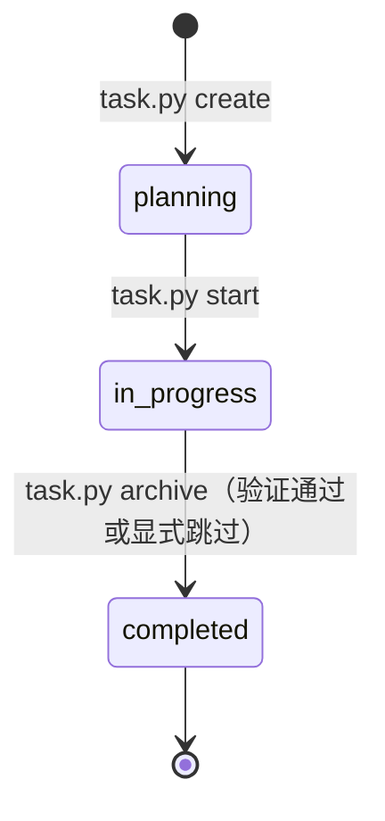

# 任务与 PRD

<MaturityBadge level="stable" />

任务（task）是 omtre 的原子工作单元，用于承载单次工程变更的需求定义、技术决策、验证契约与归档元数据。它并非 Jira 或 GitHub Issues 等团队项目协作系统的替代品，而是为 AI Agent 和工程师在仓库本地提供持久化、可审查、无幻觉的执行上下文容器。

## 目录组织与产物契约

所有活动任务均存放于 `.omtre/tasks/<MM-DD-slug>/` 目录下。归档后完整目录迁移至 `.omtre/tasks/archive/<YYYY-MM>/<MM-DD-slug>/`。

```text
.omtre/tasks/<MM-DD-slug>/
├── task.json          # 核心元数据（状态、分支、依赖、验证契约）
├── prd.md             # 需求范围、边界约束与验收标准
├── design.md          # 架构权衡、数据契约与影响面分析（复杂任务推荐）
├── implement.md       # 实现步骤拆解与自测顺序（复杂任务推荐）
├── implement.jsonl    # 实现阶段注入子代理的上下文索引
├── check.jsonl        # 审查阶段注入子代理的上下文索引
└── research/          # 任务专属的技术调研与探针日志
    └── *.md
```

产物职责划分：

| 产物 | 必要性 | 职责定位与约束 |
|---|---|---|
| `task.json` | 强制 | 机器可读的任务状态真源。由 `task.py` 工具链读写，禁止手改核心字段。 |
| `prd.md` | 强制 | 业务与技术验收契约。界定要做什么与绝对不做什（Out of Scope）。 |
| `design.md` | 按需 | 涉及跨模块变更、破坏性修改或协议调整时的设计取舍与回滚策略。 |
| `implement.md` | 按需 | 落地过程中的执行清单、断点验证命令与阶段性交付步骤。 |
| `implement.jsonl` | 按需 / 平台建议 | 子代理（Sub-agent）进入实现时读取的参考规范与调研路径索引。 |
| `check.jsonl` | 按需 / 平台建议 | 审查子代理（Reviewer）用于独立比对验证的标准规范清单。 |
| `research/*.md` | 按需 | 调研结论、第三方库技术验证与备选方案取舍，供后续阶段溯源。 |

## 任务状态机

任务生命周期由确定性状态机约束，状态的跃迁依赖工具链命令触发：



核心状态定义：

- `planning`：计划期。需求澄清、架构设计、调研与验证契约制定阶段。此时任务尚未分配活动工作流槽位。
- `in_progress`：实施期。代码修改、本地断点测试与阶段性验证。同一工程师会话通常只激活一个 `in_progress` 任务。
- `completed`：完成期。由 `task.py archive` 写入。默认会重放验证契约并检查分支元数据；验证失败可修复后用 `--skip-verify "<reason>"` 显式跳过并记录原因。

### 常用状态流转命令

创建任务：

```bash
python3 .omtre/scripts/task.py create "Add order status filter" \
  --slug order-status-filter \
  --description "Let users filter orders by existing status values" \
  --domain orders \
  --priority P1
```

- 标题与描述必须具有明确语义，严禁空值或占位符。
- `--slug` 必须遵循目录命名约束，不得包含路径分隔符。
- `--no-start` 可阻止新建任务自动抢占当前开发者的活跃任务指针。

激活任务：

```bash
python3 .omtre/scripts/task.py start .omtre/tasks/<task-dir>
```

`start` 在任务处于 `planning` 时把状态切换为 `in_progress`，写入当前分支，并尝试绑定当前会话指针。其他状态不会被强制改写；空的上下文清单、领域冲突、缺少 PRD Domain 行或配置要求的验证契约都可能让 `start` 拒绝执行。

释放与归档：

```bash
# 仅清除当前会话对该任务的激活指针，不改变任务状态，不归档
python3 .omtre/scripts/task.py finish

# 执行验证契约、锁定元数据、移入 archive 目录并生成簿记提交
python3 .omtre/scripts/task.py archive .omtre/tasks/<task-dir>
```

## JSONL 上下文注入规范

在具备子代理分工的执行环境中，`implement.jsonl` 与 `check.jsonl` 决定了注入给实现者或审查者的提示词边界。

### 语法与文件格式

每行必须为独立的合法 JSON 对象：

```json
{"file": ".omtre/spec/backend/index.md", "reason": "后端 API 响应包装与异常码标准"}
{"file": ".omtre/tasks/10-26-order-filter/research/api-bench.md", "reason": "历史接口性能基准与限流参数"}
```

可使用工具追加条目：

```bash
python3 .omtre/scripts/task.py add-context \
  .omtre/tasks/<task-dir> \
  implement \
  ".omtre/spec/backend/index.md" \
  "后端统一响应结构规范"
```

### 严禁注入业务源码路径

上下文清单的技术刚性约束：**条目只能指向规范（`.omtre/spec/**`）、文档（`docs/**`）或任务自身的调研产物（`{TASK_DIR}/research/**`），严禁注入业务源码文件路径（如 `src/**/*.ts`, `app/**/*.py` 等）。**

`task.py validate` 会对非豁免路径的源码后缀条目发出强警告。这一约束基于明确的软件工程与 LLM 行为学原理：

1. **子代理具备完备的代码检索与探索能力**：现代 Agent 拥有 ripgrep、LSP 与文件树分析工具，能够自主按需定位符号调用拓扑。
2. **避免上下文腐化与单点断裂**：业务源码在开发过程中高频重命名、拆分或重构。硬编码源码路径会导致清单迅速失效。
3. **防止诱发先入为主的认知偏见**：在系统提示词中直接注入具体源码片段，会强制占据注意力权重（Attention Sink），诱使子代理过早收敛并锚定在局部已有实现上，忽视调用链上下游、全局架构模式与边缘测试用例。

```bash
# 校验上下文清单的合法性与代码隔离合规性
python3 .omtre/scripts/task.py validate .omtre/tasks/<task-dir>
```

## 父子任务与依赖图谱

复杂需求必须通过父子层级或阻断依赖进行解构，严禁建立横跨数十个文件、包含数十项验收指标的超级单体任务。

### 层次划分：包含而非时序

父子关系表达的是**范围拆解与聚合验收**（Composition），而非时间先后顺序：

```bash
# 创建挂载于父任务下的子任务
python3 .omtre/scripts/task.py create "Order filter API endpoint" \
  --slug order-filter-api \
  --description "Implement backend query parameters" \
  --parent .omtre/tasks/<parent-dir>

# 关联或解绑子任务
python3 .omtre/scripts/task.py add-subtask <parent-dir> <child-dir>
python3 .omtre/scripts/task.py remove-subtask <parent-dir> <child-dir>
```

- 父任务聚合总体 PRD、系统架构约束与最终集成检查。
- 子任务独立管理自己的分支、测试与验证契约。

### 进度聚合逻辑

父任务通过状态计算机制实时呈现子任务完成度（例如 `[2/3 done]`）：

- 当子任务处于活跃目录中且状态为 `completed` 时，计为完成。
- 当子任务已完成并归档至 `.omtre/tasks/archive/` 目录时，`task.py` 通过缺失状态识别将其依然计为已完成，确保父任务的整体完成度不会因单项子任务归档而出现统计回退。
- 团队流程应在所有子任务完成后才归档父任务；`task.py archive` 本身不会检查子任务状态。

### 强依赖拓扑（Blocked By）

当多个子任务存在时序依赖时，必须显式声明阻塞关系：

```bash
python3 .omtre/scripts/task.py set-meta <child-dir> \
  blocked_by "<blocker-dir-1> <blocker-dir-2>"
```

通过 frontier 指令计算当前可立即开工的无阻塞任务前沿集合：

```bash
python3 .omtre/scripts/task.py frontier
```

只有当 `blocked_by` 列表中的所有前置任务均已进入 `completed` 状态或已归档，依赖任务才会出现在 `frontier` 推荐列表中。

## 常用操作参考

```bash
# 列出当前所有活动任务及其子任务聚合进度
python3 .omtre/scripts/task.py list

# 仅查看指派给当前开发者的任务
python3 .omtre/scripts/task.py list --mine

# 按状态筛选（例如 planning / in_progress / completed）
python3 .omtre/scripts/task.py list --status planning

# 查看当前开发者会话绑定的任务路径与来源
python3 .omtre/scripts/task.py current --source

# 列出指定月份已归档的历史任务
python3 .omtre/scripts/task.py list-archive 2026-10
```

## 操作红线

- **严禁手工篡改 `task.json` 的 `status` 字段**：绕过状态机意味着跳过验证契约执行与元数据审计。
- **严禁删除任务目录代替归档**：历史任务是后续类似功能调研和故障复盘的同源上下文。
- **严禁将业务代码提交混入任务归档提交**：业务代码应在常规 PR 分支中由工程师显式 commit，`task.py archive` 仅负责元数据迁移与状态标记。

## 下一步

- [规范系统](./specs.md)：决定实现与审查阶段应当注入和遵从的工程法则。
- [工作区与开发者记忆](./workspace-memory.md)：了解个人会话状态与团队共享事实的隔离机制。
- [质量检查与提交](./quality-and-commit.md)：掌握本地验证契约与归档提交的刚性界限。
- [task.json 模式参考](../reference/task-schema.md)：查阅元数据完整字段定义与读写约定。
