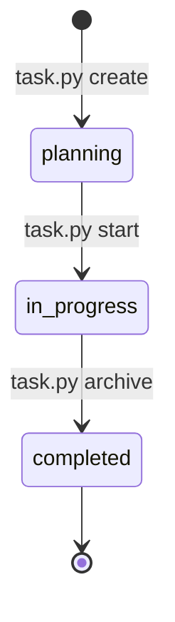

# 任务与 PRD

<MaturityBadge level="stable" />

任务（task）是 omtre 中一次可计划、实现、检查和归档的工作单元。它不是 Issue Tracker 的替代品，而是 Agent 在当前仓库里理解“这次改什么”的持久化容器。

## 任务目录

```text
.omtre/tasks/<MM-DD-slug>/
├── task.json
├── prd.md
├── design.md          # 复杂任务
├── implement.md       # 复杂任务
├── implement.jsonl    # 支持的平台会生成
├── check.jsonl        # 支持的平台会生成
└── research/
    └── *.md
```

| 产物 | 必填 | 作用 |
|---|---|---|
| `task.json` | 是 | 状态、范围、分支、依赖和验证元数据 |
| `prd.md` | 是 | 要解决的问题、范围、排除项、验收条件 |
| `design.md` | 复杂任务 | 边界、契约、数据流、兼容和回滚 |
| `implement.md` | 复杂任务 | 执行顺序、验证命令、评审点和回滚点 |
| `implement.jsonl` | 子代理平台建议 | 实现阶段应读取的规范与调研 |
| `check.jsonl` | 子代理平台建议 | 检查阶段应读取的规范与调研 |
| `research/*.md` | 按需 | 可复查的调研结论 |

轻量任务可以只有 PRD。复杂任务不应把设计只留在聊天中。

## 生命周期



脚本实际保证的核心状态只有这三个。帮助文本中可能出现其它筛选值，但这不代表运行时会自动写入。

### `create`

创建任务目录、`task.json` 和默认 `prd.md`：

```bash
python3 .omtre/scripts/task.py create "Add order status filter" \
  --slug order-status-filter \
  --description "Let users filter orders by existing status values" \
  --domain orders \
  --priority P1
```

- 标题和描述必须非空。
- slug 不能包含路径分隔符或 `..`。
- 同名活动任务或归档任务会阻止创建。
- 有会话身份时，新任务可能自动成为当前任务。
- `--no-start` 只影响是否指向当前会话，不会把状态直接变成 `in_progress`。

### `start`

完成计划审查后激活任务：

```bash
python3 .omtre/scripts/task.py start .omtre/tasks/<task-dir>
```

`start` 可能检查：

- 已存在的 `implement.jsonl` / `check.jsonl` 是否有有效条目；
- 新领域是否已注册；
- PRD 是否有 Domain 行；
- 配置要求验证契约时，任务是否已经登记命令。

只有 `planning` 状态会翻转为 `in_progress`。如果会话身份不可用，任务状态仍可能改变，但当前任务指针无法持久化；这时需要显式重新激活。

### `finish`

清除当前会话的活动任务指针：

```bash
python3 .omtre/scripts/task.py finish
```

它不归档、不修改完成状态，也不提交代码。

### `archive`

完成任务并移动到归档目录：

```bash
python3 .omtre/scripts/task.py archive .omtre/tasks/<task-dir>
```

归档会：

- 写入 `status: completed` 与完成时间；
- 重新运行已登记的验证契约；
- 检查分支元数据；
- 把任务移到 `.omtre/tasks/archive/<YYYY-MM>/`；
- 清理指向该任务的运行时会话指针；
- 尝试创建仅包含任务簿记的提交。

验证失败会阻止归档。`--skip-verify "<reason>"` 可以显式绕过并记录原因，但团队应把这种操作视为需要解释的异常。

从未建立 PR 分支的任务，如果分支检查造成误报，可使用：

```bash
python3 .omtre/scripts/task.py archive <task-dir> --skip-branch-validation
```

不要把它当成绕过真实问题的默认选项。

## PRD 应该写什么

一个好的 PRD 让实现者不需要猜边界：

```markdown
# Order status filter

## Goal

Users can filter the existing order list by an existing status value.

## In scope

- Parse and validate the status query parameter.
- Keep "all orders" as the default.
- Add component and API tests.

## Out of scope

- Schema changes.
- Permission changes.
- Saved filters or bulk actions.

## Acceptance criteria

- No status produces the current behavior.
- A valid status returns only matching orders.
- An invalid status has a defined, tested response.
- Existing checks and new tests pass.
```

不建议把设计细节塞满 PRD。PRD 负责需求和验收，`design.md` 负责技术取舍。

## 上下文清单

`add-context` 的真实参数顺序是：

```bash
python3 .omtre/scripts/task.py add-context \
  .omtre/tasks/<task-dir> \
  implement \
  ".omtre/spec/backend/index.md" \
  "Backend conventions for this task"
```

`file` 参数只接受 `implement` 或 `check`。路径应存在，并且应指向规范或调研，不是即将修改的源码。

```bash
python3 .omtre/scripts/task.py list-context .omtre/tasks/<task-dir>
python3 .omtre/scripts/task.py validate .omtre/tasks/<task-dir>
```

如果平台生成了清单文件，但文件存在且没有任何有效条目，`start` 可能拒绝。文件不存在通常按平台差异处理，不会在所有平台被强制生成。

## 父子任务与依赖

### 父子关系

```bash
python3 .omtre/scripts/task.py create "API and data layer" \
  --slug invitations-api \
  --description "Invitation schema and API" \
  --parent .omtre/tasks/<parent-dir>

python3 .omtre/scripts/task.py add-subtask <parent-dir> <child-dir>
python3 .omtre/scripts/task.py remove-subtask <parent-dir> <child-dir>
```

父子关系表示**包含**，不代表执行顺序。父任务负责总需求、子任务映射和最终集成审查。

### 阻塞依赖

硬依赖写成 `blocked_by`：

```bash
python3 .omtre/scripts/task.py set-meta <child-dir> \
  blocked_by "<blocker-dir> <another-blocker>"
```

查看可执行任务：

```bash
python3 .omtre/scripts/task.py frontier
```

只有所有 blocker 都完成或归档，子任务才进入 ready 集合。

## 常用查询

```bash
python3 .omtre/scripts/task.py list
python3 .omtre/scripts/task.py list --mine
python3 .omtre/scripts/task.py list --status planning
python3 .omtre/scripts/task.py current --source
python3 .omtre/scripts/task.py list-archive
python3 .omtre/scripts/task.py list-archive 2026-10
```

## 不要手工做的事

- 不要手改 `status` 来跳过计划或验证。
- 不要删除任务目录来“解决”归档错误。
- 不要把多个不相关交付塞进一个任务。
- 不要用 `--force` 覆盖已有任务记录。
- 不要把代码提交和任务归档混成一个不可审查的大提交。

## 下一步

- [规范系统](./specs.md)：决定实现和检查应该读取哪些规则。
- [质量检查与提交](./quality-and-commit.md)：理解验证和归档的硬边界。
- [task.json Schema](../reference/task-schema.md)：查看字段来源与写入者。
