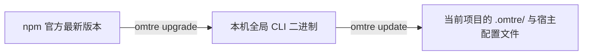

# 日常使用

<MaturityBadge level="stable" />

日常使用 omtre 的本质是驱动一套确定性的工程状态机：在保证业务代码最小修改的同时，保持任务产物、验证契约与 Git 提交边界清晰解耦。遇到边缘分支与异常时，可查阅 [CLI 参考](../reference/cli.md) 与 [故障排查](../advanced/troubleshooting.md)。

## 高频决策表

| 工程场景 | 坚决执行的动作 | 严禁行为 |
|---|---|---|
| 开始复杂业务需求 | 调度 Agent 初始化任务目录并编写 `prd.md` 冻结边界 | 未定义范围前直接大范围改写源码 |
| 跨会话继续任务 | 运行 `task.py current` 读取当前任务阶段与上下文 | 重新向会话全量粘贴背景与冗长代码 |
| 查看任务状态进度 | 查阅 `task.py current` 与 `task.json` | 手动修改 `task.json` 中的 `status` 字段 |
| 单行/打字错误等微型修复 | 允许内联修改代码并立即运行单测验证 | 为微小内联改动强行创建沉重的任务目录 |
| 完成代码实现准备交付 | 人工比对 `git diff` 并机械重放已绑定的验证契约 | 盲目相信 Agent “代码已写好、测试全通过”的口头陈述 |
| 结束并收尾当前任务 | **先完成业务代码原子 commit，再执行 `task.py archive`** | **在代码提交前执行归档；误以为归档会自动触发 `git push`** |
| 升级 CLI 核心工具 | 运行 `omtre upgrade --dry-run` 预览后执行升级 | 手工拷贝 bin 文件破坏全局软链 |
| 同步项目内置模板 | 执行 `omtre update --dry-run` 检查变更后再更新 | 盲目使用 `--force` 覆盖已有本地定制 |
| 临时排查环境与工具干扰 | 使用 `omtre ablate` 与 `omtre restore` 临时消融对比 | 将可逆的临时消融当成永久卸载 |
| 彻底移除项目内 omtre 资产 | 运行 `omtre uninstall --dry-run` 逐项审阅清单后确认 | 未检查待删受管文件前直接暴力 `rm -rf .omtre` |

## 高频工作流：从创建到归档

一次规范的日常任务生命周期严格包含六个步骤：

```text
[1. 创建任务] ──> [2. 编写 PRD] ──> [3. 编码实施] ──> [4. 验证契约] ──> [5. 代码提交] ──> [6. 归档日志]
 task.py create     prd.md 边界冻结    task.py start     run-verify       git commit       task.py archive
```

### 1. 开始一个新任务

通过自然语言发起需求，强制要求进入计划阶段，不准直接改动源码：

```text
请按 omtre 工作流处理这个需求。先不要改代码。

目标：<业务目标>
范围：<明确改动边界>
排除：<明确不做的非目标 Out of Scope>
验证：<本地已有的测试或检查命令>

请先执行 task.py create 创建任务，并在 prd.md 中冻结验收标准。
```

::: tip 区分任务模式与内联改动
对于明显的单行修补或配置微调，直接提示 Agent “跳过创建任务，直接就地修改并验证”。omtre 的目标是控制工程复杂度，而非增加教条主义负担。
:::

任务初始化完成后，核心检查四项资产：

- `prd.md`：目标（Goal）、涉及范围（In Scope）、明确排除项（Out of Scope）、验收标准（Acceptance Criteria）；
- `task.json`：初始状态必须为 `planning`，确认分支信息；
- 验证契约：是否绑定了确定性的本地可执行命令；
- 架构设计（复杂任务）：是否包含 `design.md`（技术方案与回滚点）与 `implement.md`（实施细则）。

### 2. 继续当前任务

在新的会话或中断后恢复工作时，直接唤醒上下文：

```text
继续当前任务。先读取活动任务和 workflow，
判断现在处于哪个阶段，再执行下一步。
```

Agent 在推进前必须在底层确认：
1. 当前活动任务的物理目录与 `task.json`；
2. 当前状态属于 `planning` 还是 `in_progress`；
3. PRD 是否已确认，是否已执行 `task.py start`。

### 3. 检查当前状态

使用标准脚本读取任务数据面：

```bash
# 查看当前激活的任务详情
python3 .omtre/scripts/task.py current

# 查看所有进行中任务
python3 .omtre/scripts/task.py list

# 仅查看当前开发者的任务
python3 .omtre/scripts/task.py list --mine

# 查看历史归档任务
python3 .omtre/scripts/task.py list-archive
```

### 4. 管理任务上下文

任务上下文清单（`implement.jsonl`、`check.jsonl`）仅用于注册**架构规范文件**与**前置调研成果**，绝对不要把即将修改的目标业务源码塞入清单：

```bash
# 查看当前项目支持的规范包
python3 .omtre/scripts/get_context.py --mode packages

# 添加实现阶段规范上下文
python3 .omtre/scripts/task.py add-context \
  .omtre/tasks/<task-dir> \
  implement \
  ".omtre/spec/backend/index.md" \
  "Backend conventions"

# 添加检查阶段规范上下文
python3 .omtre/scripts/task.py add-context \
  .omtre/tasks/<task-dir> \
  check \
  ".omtre/spec/backend/index.md" \
  "Verification checklist"

# 验证上下文路径有效性与 JSONL 格式
python3 .omtre/scripts/task.py validate .omtre/tasks/<task-dir>
```

### 5. 绑定与重放验证契约

编码实施完成后，将可重放的确定性命令绑定至任务契约中：

```bash
# 绑定测试或检查命令
python3 .omtre/scripts/task.py add-verify \
  .omtre/tasks/<task-dir> \
  "pnpm test"

# 手动触发契约验证重放
python3 .omtre/scripts/task.py run-verify .omtre/tasks/<task-dir>
```

验证契约默认期望退出码为 `0`，命令默认超时为 600 秒。归档时会重放契约；只要任务登记过契约且未使用 `--skip-verify`，任一命令失败都会阻止归档。无契约时是否阻断取决于 `verify_required`。

### 6. 中断与跨会话暂停

会话无需单日强行闭环。遇到阻塞需要中断时：

1. 保持当前工作区代码可解释、可编译；
2. 让 Agent 在 `implement.md` 的进度清单中打勾并追加当前断点备注；
3. **保留当前会话的任务指针**，不要执行清理动作；
4. `task.py finish` 仅用于清理本地会话的指针绑定，它不会把任务状态置为 `completed`。

### 7. 提交业务代码与任务归档

::: danger 严禁先归档后提交业务代码
必须严格按照“**先提交业务代码，后执行任务归档**”的时序操作。
如果在提交业务代码前运行 `task.py archive`，任务目录的移动改动会与业务代码修改混杂在未提交的工作区中，破坏 Git 提交历史的原子性；若归档中途校验失败，极难干净回滚业务代码。
:::

::: warning 任务归档不会自动执行 git push
`task.py archive` 仅负责本地簿记工作：重放验证契约、将任务目录迁移至 `.omtre/tasks/archive/`、将 `task.json` 状态置为 `completed` 以及清理当前活跃指针。**归档脚本绝不会代为执行 `git push`**。将代码推送到远端仓库始终是开发者的显式决定。
:::

第一步：人工比对并原子提交业务代码：

```bash
git status --short
git diff --stat
git diff

# 仅暂存本次任务范围内的业务文件
git add <file-1> <file-2>
git commit -m "feat(scope): <summary>"
```

第二步：指示 Agent 执行收尾与归档：

```text
业务代码已提交至本地 Git 仓库。
请按 omtre finish-work 流程执行 task.py archive 归档当前任务、
更新 workspace journal，并报告最终归档目录。
先不要执行 git push。
```

第三步：验证归档与日志状态：

```bash
git status --short
python3 .omtre/scripts/task.py list-archive
```

## 8. 升级 omtre

omtre 分为本机全局 CLI 与项目本地模板两个独立版本层：



升级全局 CLI：

```bash
omtre upgrade --dry-run
omtre upgrade
omtre --version
```

同步当前项目模板：

```bash
omtre update --dry-run
omtre update
```

如果存在破环性配置变更，携带 `--migrate` 执行平滑迁移：

```bash
omtre update --dry-run --migrate
omtre update --migrate
```

`omtre update` 默认保护你手动调整过的受管文件，遇到冲突应人工比对，严禁无脑追加 `--force`。

## 9. 临时停用、恢复或卸载

对比评估 omtre 对当前项目的影响：

```bash
# 临时将项目内 omtre 资产移入安全隔离区
omtre ablate --dry-run
omtre ablate

# 恢复隔离区资产
omtre restore --dry-run
omtre restore
```

若只需在当前终端临时屏蔽 Hooks：

```bash
export OMTRE_HOOKS=0
```

彻底清理项目内的 omtre 文件表面：

```bash
omtre uninstall --dry-run
omtre uninstall
```

操作影响边界对照：

| 操作指令 | `.omtre/` 资产 | 宿主平台集成文件 | 是否可逆 | 全局 CLI |
|---|---|---|---|---|
| `export OMTRE_HOOKS=0` | 完整保留 | 完整保留 | 重开终端或 unset 即可恢复 | 完整保留 |
| `omtre ablate` | 移动至隔离区 | 移动至隔离区 | 可使用 `omtre restore` 还原 | 完整保留 |
| `omtre uninstall` | 物理删除 | 物理删除 | 不可逆（需从 Git 找回） | 完整保留 |
| `npm uninstall -g omtre` | 无影响 | 无影响 | 重新 npm install 即可 | 物理卸载 |

## 10. 人工审查红线

当 Agent 提出以下诉求或产生对应操作时，必须立即人工介入接管：

- 涉及修改主干/默认分支、生产配置文件或包含敏感凭据；
- 任务涉及鉴权逻辑、支付流、加解密或核心数据模型迁移；
- 开发者无法合理解释 `git diff` 中的大片冗余变动；
- 验证契约命令执行失败，但 Agent 提议“直接跳过验证或修改测试使其绿灯”；
- 工作区出现所有权与产生路径不明的孤儿文件；
- 自动化运行器（`omtre run`）企图向未经白名单授权的分支推送提交。

## 下一步

- [真实场景](./real-world-scenarios.md)：查看已有项目接入、跨层重构与 Review 反馈等实战模式。
- [任务与 PRD](../guide/tasks.md)：深入任务生命周期与产物规范。
- [故障排查](../advanced/troubleshooting.md)：按日志与退出码定位异常。
