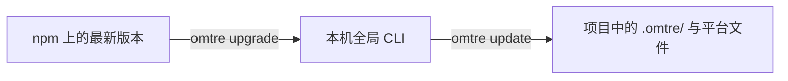

# 日常使用

<MaturityBadge level="stable" />

这一页只讲每天最常用的动作。你不需要记住全部脚本参数；遇到具体问题时再查[CLI 参考](../reference/cli.md)和[故障排查](../advanced/troubleshooting.md)。

## 高频决策表

| 我想…… | 推荐动作 | 不要做什么 |
|---|---|---|
| 开始一个复杂需求 | 让 Agent 创建任务并写 PRD | 直接让它大范围改代码 |
| 接着昨天的工作 | 让 Agent 继续当前任务 | 重新粘贴全部背景 |
| 查看现在做到哪一步 | `task.py current`、`task.py list` | 手改 `task.json.status` |
| 做一个小型内联修改 | 允许 Agent 跳过任务，直接改并验证 | 为一次单行修复制造复杂 PRD |
| 完成实现前 | 检查 PRD 和验证命令 | 只看 Agent 的完成总结 |
| 结束任务 | 先提交代码，再让 Agent 收尾 | 把归档当提交 |
| 升级 CLI | `omtre upgrade` | 在项目里手工替换全局 bin |
| 同步项目模板 | `omtre update` | 直接覆盖被修改的受管文件 |
| 尝试临时移除 omtre | `omtre ablate` 后 `omtre restore` | 把临时消融当永久卸载 |
| 永久移除 | `omtre uninstall --dry-run` 后确认 | 未检查清单直接删除 |

## 1. 开始一个新任务

用自然语言描述需求，并明确要求先计划：

```text
请按 omtre 工作流处理这个需求。先不要改代码。

目标：<业务目标>
范围：<已知边界>
不要做：<明确排除项>
验证：<现有测试或检查命令>

请先创建任务、写 PRD，复杂任务再补 design/implement。
```

对于简单问题或单行修复，可以向 Agent 明确说明“这次不需要创建任务”。omtre 不应该把每个问答都变成任务。

### 任务创建后先看什么

- `prd.md`：Goal、In scope、Out of scope、Acceptance criteria；
- `task.json`：`status`、`branch`、`base_branch`；
- 验证契约：是否记录真实命令；
- 复杂任务的 `design.md` / `implement.md`：边界、回滚和验证点。

## 2. 继续当前任务

最稳妥的方式是直接说：

```text
继续当前任务。先读取活动任务和 workflow，
判断现在处于哪个阶段，再执行下一步。
```

如果宿主提供了生成好的 continue 命令，可以直接调用它。不同平台命令文件名和调用语法不同，以初始化后的平台目录为准。

继续任务时，Agent 应该先确认：

- 当前活动任务是哪一个；
- 状态是 `planning` 还是 `in_progress`；
- 缺哪些产物；
- 下一步是计划、实现、检查还是收尾。

如果 Agent 直接从半途开始写代码，让它重新读取任务和 workflow。

## 3. 检查当前状态

```bash
python3 .omtre/scripts/task.py current
python3 .omtre/scripts/task.py list
python3 .omtre/scripts/task.py list --mine
```

查看归档：

```bash
python3 .omtre/scripts/task.py list-archive
```

::: tip 状态以代码为准
文档中的状态描述和实际 `task.json` 不一致时，先检查当前安装版本。
:::

## 4. 管理任务上下文

上下文清单只放**规范文件**和**任务调研文件**，不要放即将修改的源码。

```bash
# 查看规范包与层
python3 .omtre/scripts/get_context.py --mode packages

# 添加实现上下文
python3 .omtre/scripts/task.py add-context \
  .omtre/tasks/<task-dir> \
  implement \
  ".omtre/spec/backend/index.md" \
  "Backend conventions"

# 添加检查上下文
python3 .omtre/scripts/task.py add-context \
  .omtre/tasks/<task-dir> \
  check \
  ".omtre/spec/backend/index.md" \
  "Verification checklist"

# 校验路径与 JSON 格式
python3 .omtre/scripts/task.py validate .omtre/tasks/<task-dir>
```

注意参数顺序是 `<任务目录> <implement|check> <文件路径> [原因]`。

## 5. 登记和运行验证

实现完成后，把可重放的真实命令写进任务：

```bash
python3 .omtre/scripts/task.py add-verify \
  .omtre/tasks/<task-dir> \
  "pnpm test"

python3 .omtre/scripts/task.py run-verify .omtre/tasks/<task-dir>
```

验证契约默认期望退出码为 `0`，超时为 600 秒，可以按任务覆盖。

归档时如果契约存在，命令会再次运行；失败就不能归档。无契约是否阻断取决于 `verify_required` 配置和自治模式。团队试点建议显式设为 `true`。

## 6. 停在一个任务中间

你可以停止会话，不必当天完成。建议：

- 确保当前代码改动可解释；
- 让 Agent 在任务 `implement.md` 或 notes 中记录剩余步骤；
- 不要清理任务指针，除非确实结束本次会话；
- 下次从“继续当前任务”开始。

`task.py finish` 只清除当前会话的活动任务指针，不会归档，也不会把状态改成完成。

## 7. 提交与收尾

提交前：

```bash
git status --short
git diff --stat
git diff
```

只暂存本次确认过的文件：

```bash
git add <file-1> <file-2>
git commit -m "feat(scope): <summary>"
```

然后让 Agent 做任务收尾：

```text
代码已提交。请按 omtre finish-work 流程归档当前任务、
更新我的 workspace journal，并报告归档路径。
先不要 push。
```

收尾成功后检查：

```bash
git status --short
python3 .omtre/scripts/task.py list-archive
```

## 8. 升级 omtre

omtre 有两个需要分别更新的版本层：



先升级全局 CLI：

```bash
omtre upgrade --dry-run
omtre upgrade
omtre --version
```

再在项目里同步模板：

```bash
omtre update --dry-run
omtre update
```

如果更新提示存在迁移，先预览再执行：

```bash
omtre update --dry-run --migrate
omtre update --migrate
```

`update` 默认不应覆盖你修改过的受管文件。遇到冲突时选择跳过、创建 `.new` 或人工合并，不要无脑 `--force`。

## 9. 临时停用、恢复或卸载

只想暂时比较 omtre 对项目的影响：

```bash
omtre ablate --dry-run
omtre ablate
omtre restore --dry-run
omtre restore
```

只想关闭 hooks：

```bash
export OMTRE_HOOKS=0
```

永久移除项目内 omtre 表面：

```bash
omtre uninstall --dry-run
omtre uninstall
```

三者边界不同：

| 操作 | `.omtre/` | 平台文件 | 可恢复 | 全局 CLI |
|---|---|---|---|---|
| `OMTRE_HOOKS=0` | 保留 | 保留 | 关掉环境变量即可 | 保留 |
| `ablate` | 临时移除 | 临时移除 | 使用 `restore` | 保留 |
| `uninstall` | 删除 | 删除 | 不能由 omtre 恢复 | 保留 |
| `npm uninstall -g omtre` | 不影响 | 不影响 | 可重装 CLI | 删除 |

## 10. 什么时候该问人

遇到以下情况先停下来：

- 需要改默认分支、生产配置或密钥；
- 任务涉及数据迁移、鉴权、支付或隐私；
- 你无法解释 Agent 的大部分 diff；
- 验证命令失败但 Agent 建议“跳过验证”；
- 出现构造/所有权不明的仓库文件；
- `ablate`/`restore` 报告冲突；
- `omtre run` 准备推送非任务分支。

## 下一步

- [真实场景](./real-world-scenarios.md)：把工作流映射到具体研发场景。
- [任务与 PRD](../guide/tasks.md)：掌握完整的任务边界。
- [故障排查](../advanced/troubleshooting.md)：出现异常时按证据排查。
