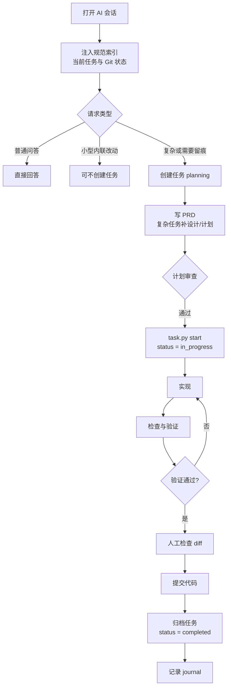

# 工作原理

<MaturityBadge level="mixed" />

完成第一个任务后，再理解工作机制会更容易。这一页不列出所有命令，而是回答三个问题：

1. Agent 在会话开始时看到了什么？
2. 一次任务如何从需求走到归档？
3. 哪些规则真的会阻断操作，哪些只是工作流指令？

## 一张图看完整生命周期



这条流程描述的是推荐路径。不同平台的加载方式、人工确认点和命令入口会不同，但任务产物和脚本边界是共享的。

## 会话开始时发生了什么

支持 SessionStart 或等价入口的平台，会向 Agent 提供一份紧凑的启动上下文，通常包括：

- 开发者身份；
- 当前分支、Git 状态和最近提交；
- 当前会话的活动任务；
- `.omtre/workflow.md` 的阶段索引；
- 相关规范索引的位置；
- workspace 的最近记忆线索。

它通常不是把整个工作流和所有规范一次性塞进上下文。Agent 应该在需要具体步骤时再加载更细的说明。

| 平台类型 | 典型加载方式 | 需要你注意什么 |
|---|---|---|
| 有 SessionStart hooks 的平台 | 自动注入紧凑上下文 | 确认 hooks 已安装，项目被宿主信任 |
| pull-based 子代理平台 | 子代理按角色卡自行读取任务文件 | 任务和 JSONL 路径必须准确 |
| inline 或约定型平台 | 主会话读取技能/工作流 | 首次会话可能要求 Agent 显式读取入口 |
| 无自动注入的平台 | 靠命令、prompt 或人工提示 | 不要把“已生成文件”当成“自动加载” |

具体矩阵见[平台支持矩阵](../reference/platform-matrix.md)。

## 三层约束，不要混淆

omtre 里的规则大致分为三层。

### 1. 机械脚本闸门

这些规则由 Python/TypeScript 脚本执行，满足条件才会继续。例如：

- 任务处于 `planning` 时，`start` 才会翻转为 `in_progress`；
- 某些平台下，空的任务上下文清单会让 `start` 拒绝继续；
- 任务登记了验证契约时，归档会重新运行命令，失败则不归档；
- 受管文件删除、迁移和消融都有特定预检；
- `omtre run` 推送受交付门和分支白名单控制。

机械闸门不等于安全沙箱。它只约束它实际检查的条件。

### 2. 平台注入与上下文范围

任务上下文清单（`implement.jsonl`、`check.jsonl`）用于告诉子代理应该读取哪些规范和调研文件。它控制的是“给 Agent 什么材料”，不保证 Agent 必然遵守材料。

不同平台支持程度不同：

- 一些平台由 hook 注入；
- 一些平台由子代理自行读取；
- 一些平台没有子代理，只在主会话中加载技能；
- 某些清单文件在某些平台不会生成。

### 3. 提示词与人工审查

大部分流程规范属于这一层，例如：

- 先计划再实现；
- 不提交未识别文件；
- 规范问题只报告，不自动改写；
- 人工确认 PRD 和最终 diff；
- 复杂变更需要 design 和 implement 计划。

这些要求很重要，但不是不可绕过的技术限制。团队审查和仓库权限仍然必须存在。

::: danger 不要把“工作流承诺”当成安全控制
例如，omtre 可以要求“不要 push 主分支”，但真正的强制控制应来自 Git 平台的分支保护、凭据权限和 CI。文档会明确区分“脚本会拒绝”与“Agent 应该遵守”。
:::

## 任务状态

脚本实际会写入的核心状态是：

```text
planning -> in_progress -> completed
```

| 状态 | 何时写入 | 含义 |
|---|---|---|
| `planning` | `task.py create` | 任务存在，正在确认需求与计划 |
| `in_progress` | `task.py start` | 计划已确认，可以进入实现 |
| `completed` | `task.py archive` | 任务完成并移入归档 |

`task.py finish` 只清理当前会话的任务指针，不会把状态改成 `completed`。真正完成需要归档。

## `.omtre/` 中的文件如何协作

| 文件或目录 | 谁写 | 谁读 | 作用 |
|---|---|---|---|
| `workflow.md` | `omtre init` / `omtre workflow` | 主会话、hooks、技能 | 阶段与步骤契约 |
| `spec/**/index.md` | 人或 Agent，经审查 | 会话、子代理、技能 | 规范入口 |
| `tasks/<dir>/prd.md` | 计划阶段 | 实现、检查、人工 | 需求与验收边界 |
| `tasks/<dir>/design.md` | 复杂任务计划阶段 | 实现与检查 | 技术设计与回滚 |
| `tasks/<dir>/implement.md` | 复杂任务计划阶段 | 实现与检查 | 执行顺序与验证点 |
| `tasks/<dir>/*.jsonl` | 计划阶段 | 支持的平台/子代理 | 稳定上下文清单 |
| `tasks/<dir>/task.json` | 任务脚本 | 运行时、hooks、`omtre run` | 状态与元数据 |
| `workspace/<dev>/journal-*.md` | 收尾脚本 | 下次会话、人工 | 跨会话记忆 |
| `config.yaml` | 人或管理员 | 脚本与 CLI | 项目级配置 |

## 计划阶段为什么重要

计划不是为了生成更多文档，而是把三类风险提前暴露：

1. **范围风险**：需求边界不清，实现会随意扩张；
2. **技术风险**：数据流、兼容性、回滚方式没有想清楚；
3. **验证风险**：做完以后才发现没有可执行的检查。

轻量任务可以只有 PRD。复杂任务应补 `design.md` 和 `implement.md`。是否“复杂”由变更影响的边界判断，不由文件数量单独决定。

## 检查阶段实际检查什么

检查通常包含两个轴：

- **规范轴**：改动是否符合团队规范、项目约定和任务产物；
- **验证轴**：lint、类型检查、测试等命令是否真实通过。

规范轴目前主要是 Agent 审查，属于提示词与角色卡约束。验证轴可以由任务验证契约机械重放。

一个完整的检查结果应回答：

- 改了哪些文件；
- 哪些规范适用；
- 哪些命令实际执行了，退出码是什么；
- 发现的问题哪些已修复、哪些仍需人判断；
- 是否存在超出 PRD 的改动。

## 收尾为什么分三步

推荐顺序是：

```text
工作代码提交
  -> 任务归档
  -> journal 记录
```

原因是它们产生不同审阅单元：

- 代码提交需要 Review；
- 归档提交记录任务状态变化；
- journal 提交记录本次会话的证据与结论。

把三者混在一起会让代码 Review 被大量簿记文件干扰，也会让回滚变得困难。

## 无人值守运行不是默认路径

`omtre run` 在独立 worktree 中取任务、调用 worker、验证、记录 ledger，并在允许时执行交付。它建立在同一套任务和验证契约上，但增加了很多运行条件：

- 任务需要 branch/base 和可运行的验证命令；
- worker 必须是受支持的 provider；
- 交付需要配置与白名单同时允许；
- 真实模型长期运行的可靠性仍需试点；
- 它不会自动合并 PR。

首次接触 omtre 时不需要开启无人值守。先让普通会话闭环可靠，再考虑运行器。

## 下一步

- [日常使用](./everyday-use.md)：把流程压缩成日常决策。
- [任务与 PRD](../guide/tasks.md)：深入任务生命周期和产物。
- [质量检查与提交](../guide/quality-and-commit.md)：理解验证、归档和提交的硬边界。
