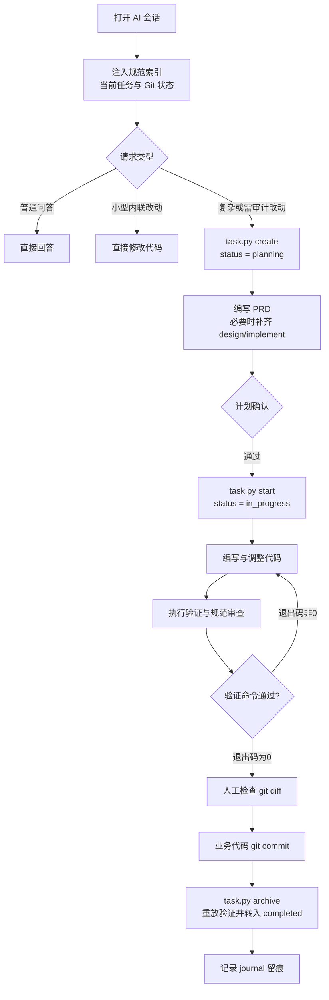

# 工作原理

<MaturityBadge level="mixed" />

omtre 的核心机制是通过确定性的文件契约与轻量宿主脚本，将无状态的 LLM 交互固化为受控的工程交付闭环。系统在生命周期流转、上下文注入与门禁校验上具备清晰的技术边界。

## 完整执行生命周期



omtre 将任务划分为四个关键阶段（Phase），各阶段具备明确的技术事实：

1. **`planning`（计划阶段）**：执行 `task.py create` 创建任务目录与元数据 `task.json`，初始化 `prd.md`。此时状态锁死为 `planning`，不允许执行依赖实现上下文的 worker 逻辑。
2. **`implement`（实现阶段）**：执行 `task.py start` 校验前置契约，将状态机翻转为 `in_progress`。所有改动限定在明确的作用域内，根据 PRD 逐步编码。
3. **`verify`（验证阶段）**：在归档前运行已绑定的测试、类型检查或 lint 契约。验证退出码只是归档条件之一；分支元数据、上下文清单和项目配置也可能阻止归档。
4. **`archive`（归档阶段）**：在代码提交后执行 `task.py archive`。脚本会强制重放验证命令并移动任务至归档区，状态更新为 `completed`。

## 上下文注入机制：子代理与内联模式

在支持不同工作模式的平台上，Agent 接收上下文的方式存在本质差异：

```text
┌───────────────────────────────────────────────────────────────┐
│ 子代理（Sub-agent）模式: 物理隔离与清单式按需拉取              │
│ 计划产物 ──> implement.jsonl / check.jsonl ──> Worker 显式读取  │
└───────────────────────────────────────────────────────────────┘

┌───────────────────────────────────────────────────────────────┐
│ 内联（Inline）模式: 共享上下文与动态技能注入                  │
│ 会话初始化 ──> SessionStart Hooks / 技能挂载 ──> 主会话动态提示词 │
└───────────────────────────────────────────────────────────────┘
```

- **子代理（Sub-agent）模式**：采用拉取式上下文（Pull-based）。Agent 平台按角色卡派发独立 Worker 进程，omtre 在计划阶段生成只读清单（`implement.jsonl`、`check.jsonl`），子代理再按清单读取规范。是否隔离历史消息由宿主实现决定；这种隔离能减少上下文串扰，但不能保证模型不产生误判。
- **内联（Inline）模式**：在单会话或无子代理隔离的平台上，omtre 依赖宿主环境的 `SessionStart` hooks 自动注入当前任务与 Git 状态摘要，或者由主会话直接调用注入的工具技能（Skills）。此模式下规则与对话处于同一上下文空间，需注意避免过长会话导致的指令遗忘。

| 平台机制 | 核心注入通道 | 技术事实与约束 |
|---|---|---|
| 原生支持 SessionStart 的平台 | Hooks 自动拼装紧凑上下文并注入 | 仅在会话启动瞬间执行一次，依赖宿主信任配置 |
| 进程隔离的子代理平台 | Worker 按 JSONL 清单按需读取 | 清单路径必须真实有效，不自动把整个仓库塞入上下文 |
| 无隔离的内联/技能平台 | 主会话调用 `omtre` 暴露的技能或手动引导 | 上下文与对话共享，依赖模型遵循工具调用规范 |
| 无注入机制的基础 CLI | 终端命令与人工 Prompt 输入 | 文件生成不等于已加载，必须由人工或外层脚本传入指令 |

详细兼容情况见[平台支持矩阵](../reference/platform-matrix.md)。

## 规则分类：机械脚本判定 vs 上下文引导

omtre 系统中的约束明确划分为不同执行层级，不能将语言模型的提示词引导与操作系统的机械阻断混为一谈。

### 1. 机械脚本判定（硬性阻断）

此类规则由 Python/TypeScript 脚本在宿主操作系统进程中同步执行，依赖退出码与文件系统状态判定，无法通过自然语言绕过：

- **验证退出码阻断归档**：任务登记了验证契约且未使用 `--skip-verify` 时，`task.py archive` 会在仓库中重新执行契约命令。进程退出码非 0 时，归档停止并保留任务。无契约时是否阻断取决于 `verify_required`。
- **状态与前置条件检查**：`task.py start` 只在 `planning` 状态下把任务翻转为 `in_progress`；其他状态保持原值。空的上下文清单、领域冲突或缺少必需产物都可能让 `start` 拒绝执行。
- **上下文清单非空校验**：在生成了 `implement.jsonl` / `check.jsonl` 的平台，已存在但没有任何有效条目的清单会被脚本拒绝；文件不存在时不触发该检查。
- **发布推送控制**：`omtre run` 在分支不在白名单或交付门禁未通过时，直接终止 Git push 进程。

### 2. 上下文提示词引导（软性约束）

此类规则存在于工作流定义、阶段规范及 Prompt 中，通过给 LLM 提供上下文建议生效：

- “先编写 PRD 再进入实现阶段”；
- “修改代码前先查阅关联规范”；
- “规范问题只在报告中列出，不擅自批量修改”；
- “单次任务圈定最小修改范围”。

**技术事实与边界界定**：在未配置强制性 Git Hooks 或 IDE 平台拦截脚本时，“先写计划后编码”在技术上属于软性引导。语言模型有可能在提示词衰减时跳过设计直接改动源码。

::: danger 提示词不是安全隔离机制
任何由 Agent 遵守的“工作流承诺”（例如禁止直接 Push 主分支、修改需通过人审）都属于模型推理层面的建议。生产环境中的最终安全控制必须建立在 Git 分支保护规则、只读权限凭据以及独立 CI/CD 流水线上。
:::

## 核心状态机

任务状态严格记录在 `.omtre/tasks/<task_name>/task.json` 中：

```text
planning -> in_progress -> completed
```

| 状态 | 写入动作 | 脚本行为与状态变化 |
|---|---|---|
| `planning` | `task.py create <name>` | 创建目录、`task.json` 和初始 `prd.md`；能解析会话标识时绑定当前任务，`--no-start` 可关闭 |
| `in_progress` | `task.py start <name>` | 任务处于 `planning` 时翻转为 `in_progress`，并尝试记录当前任务指针 |
| `completed` | `task.py archive` | 验证通过（或显式跳过）并完成归档检查后，把任务移入归档区 |

`task.py finish` 仅用于清空当前会话的活跃任务指针，**不会**将状态置为 `completed`。任务的真正生命周期终点必须是经过验证重放的 `archive`。

## 文件拓扑与协作职责

`.omtre/` 目录下的核心文件各司其职，构成人机协作的数据面：

| 文件 / 路径 | 写入主体 | 读取主体 | 技术职责 |
|---|---|---|---|
| `workflow.md` | `omtre init` / `omtre workflow` | 主会话、Hooks、技能 | 阶段转换定义与全局规范索引 |
| `spec/**/index.md` | 开发者或经人审的 Agent | 会话、子代理、技能 | 领域架构设计与编码约束规则 |
| `tasks/<dir>/prd.md` | 计划阶段（Agent / 人工） | 实现阶段、检查阶段 | 任务目标、验收标准与影响边界 |
| `tasks/<dir>/design.md` | 复杂任务计划阶段 | 实现与审查人员 | 架构方案、向后兼容性与回滚策略 |
| `tasks/<dir>/implement.md` | 复杂任务计划阶段 | 实现阶段 Worker | 编码步骤拆解与局部验证点 |
| `tasks/<dir>/*.jsonl` | 计划阶段 | 进程隔离的子代理 | 物理上下文加载路径清单 |
| `tasks/<dir>/task.json` | 宿主任务脚本 | 运行时、Hooks、`omtre run` | 状态机、分支名、验证契约元数据 |
| `workspace/<dev>/journal-*.md` | 收尾脚本 / Agent | 跨会话 Agent、团队审计 | 会话操作记录、关键决策与证据留痕 |
| `config.yaml` | 仓库维护者 | CLI 与脚本 | 项目全局门禁、分支策略与运行时配置 |

## 计划阶段的技术目标

计划阶段产物不是冗余文档，其核心目的在于提前冻结风险：

1. **边界冻结**：通过 `prd.md` 明确声明非目标（Out of Scope），防止模型在推理过程中发散修改无关代码；
2. **兼容性与回滚预案**：通过 `design.md` 提前定义数据结构变更与回滚路径；
3. **验证闭环绑定**：在修改任何源码前，先在计划中明确待运行的测试用例与验证命令。

简单修复仅需维护 `prd.md`；涉及跨模块协议变动或核心逻辑重构时，补充 `design.md` 与 `implement.md` 是避免模型陷入死循环调试的有效手段。

## 检查阶段的双轴度量

检查阶段包含两个正交的评估维度：

```text
┌────────────────────────────────────────────────────────┐
│ 规范轴（Agent 语义审查）                               │
│ · 检查改动范围是否溢出 PRD 约定                       │
│ · 检查是否违反 spec 架构约束                           │
│ · 产出审查报告供人工决策                               │
├────────────────────────────────────────────────────────┤
│ 验证轴（脚本机械判定）                                 │
│ · 运行 test / lint / typecheck                         │
│ · 进程退出码必须为 0                                   │
│ · 作为归档前置硬门禁                                   │
└────────────────────────────────────────────────────────┘
```

检查阶段产出的完整评估必须明确：变更的文件清单、适用的规范条目、实际执行的命令及其原始退出码、发现的缺陷中已修复与待人工决策的清单。

## 收尾三阶段解耦

omtre 要求遵循严格的收尾步骤解耦：

```text
业务代码 Git Commit
  └──> 任务归档（task.py archive）
        └──> 会话日志记录（journal 沉淀）
```

将这三者拆分为独立动作的技术考量：

- **审阅单元清晰**：业务代码修改提交保持原子性，Pull Request 审查时不被任务元数据与日志文件干扰；
- **Git 历史可追溯**：任务归档与工作日志变更属于管理簿记，与业务逻辑回滚解耦；
- **防止状态幽灵**：严禁在未提交业务代码前先归档任务，避免出现代码未固化而任务元数据已被标记为 `completed` 的脏状态。

## 自动化运行器（omtre run）定位

`omtre run` 是在独立 Git Worktree 中执行的无干预运行模式。它依赖已建立的契约（PRD、验证命令、明确的分支），并在执行完 worker 后强制跑测试、记账 ledger 以及受控推送。

在日常交互中，应先让人机交互的会话闭环稳定运行，熟悉任务生命周期与门禁机制后，再将结构化良好的确定性任务交给 `omtre run` 处理。

## 下一步

- [日常使用](./everyday-use.md)：掌握日常开发的高频状态流转与关键决策。
- [任务与 PRD](../guide/tasks.md)：深入任务生命周期和产物。
- [质量检查与提交](../guide/quality-and-commit.md)：理解验证、归档和提交的硬边界。
