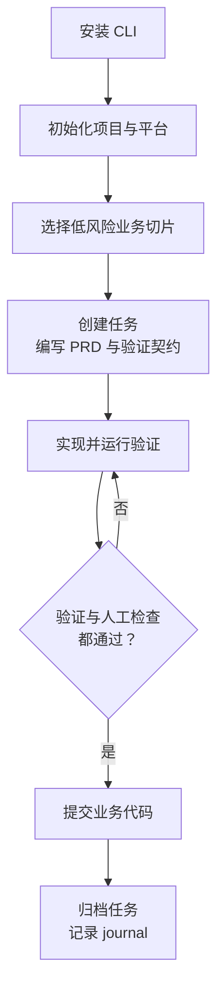

# 安装与第一个任务

<MaturityBadge level="mixed" />

在现有项目中落地 omtre，最直接的方式是完成一次真实的低风险业务功能演练。

首个试点任务应当满足三个硬性条件：**改动范围可控、现有自动化测试可覆盖、可通过独立分支干净回滚**。完成本次演练后，仓库中将完整沉淀出需求 PRD、代码改动、验证记录、任务归档与会话日志。

演练耗时预计 15–20 分钟（以选定业务切片后开始计时，不含基础环境安装与依赖下载耗时）。

## 你将完成什么



这张图里的“验证通过”指任务登记的命令返回成功；如果你显式跳过了验证，需要在任务记录中保留原因。

## 1. 检查前置条件

项目开发环境需要满足：

- Node.js **18.17 或更高**（CLI 运行所需）；
- Python **3.9 或更高**（仓库内 `.omtre/scripts/` 工作流脚本基于 Python 原生执行）；
- Git；
- 一个可用的 AI 编码代理（如 Claude Code、Cursor、Qoder、Codex 等）；
- 一个工作区干净的现有项目仓库。

```bash
node --version
python3 --version
git --version
```

Windows 环境下若 `python3` 不存在，请验证 `python --version`。如果当前项目连一条能够正常通过的 lint 或单测命令都没有，建议先在练习仓库中上手，切勿直接在缺少测试防护的仓库中试点。

检查 Git 工作区状态：

```bash
git status --short --branch
```

如果存在未提交的代码改动，请先提交或 `git stash` 暂存。带着脏工作树开始新任务会导致后续无法辨清哪些修改由本次任务引入。

## 2. 安装 omtre

```bash
npm install -g omtre
omtre --version
```

版本应输出 `1.0.0` 或当前最新发布版本。无法直连 npm 时，可从 GitHub Releases 下载对应的 tgz 文件进行离线安装。

::: tip 关键概念：全局 CLI upgrade vs 仓库内 update
- `npm install -g omtre` 仅升级安装在你本机操作系统全局的 CLI 二进制工具；
- 全局升级**绝不会擅自修改**你项目仓库中已受控的 `.omtre/` 脚本、配置或平台文件；
- 仓库内受管文件的更新由项目维度的 `omtre update` 显式完成，二者完全解耦。
:::

## 3. 初始化项目和平台

初始化时**仅勾选你团队实际使用的平台**，避免无意义地生成未用宿主的配置文件。选择对应命令执行：

::: code-group

```bash [Qoder]
omtre init -u <your-name> --qoder
```

```bash [Claude Code]
omtre init -u <your-name> --claude
```

```bash [Codex]
omtre init -u <your-name> --codex
```

```bash [Cursor]
omtre init -u <your-name> --cursor
```

```bash [GitHub Copilot]
omtre init -u <your-name> --copilot
```

:::

将 `<your-name>` 替换为你本人的开发者标识。该参数会把名字写入 `.omtre/.developer`，并创建个人工作区 `.omtre/workspace/<your-name>/`。它是本地身份标记，不是登录凭据或权限凭证。

如需同时适配多个主力平台，可组合传入对应标志：

```bash
omtre init -u your-name --qoder --claude
```

查看当前仓库已识别并启用的平台配置：

```bash
omtre platforms
```

::: tip 平台并非绝对等价
不同 AI 宿主对 slash commands、技能系统（skills）、子代理与 hooks 的开放程度各不相同。omtre 会为 22 个平台生成对应文件，但宿主端行为与验证深度并不相同；上列 5 个平台更适合作为首次试点。完整特性支持见[平台支持矩阵](../reference/platform-matrix.md)。
:::

## 4. 确认初始化成功

初始化后至少应看到：

```text
your-project/
├── .omtre/
│   ├── workflow.md
│   ├── config.yaml
│   ├── spec/
│   ├── tasks/
│   ├── workspace/
│   │   └── <your-name>/
│   ├── agents/
│   └── scripts/
│       ├── task.py
│       └── get_context.py
├── .qoder/                  # 或你选择的其他平台目录
└── AGENTS.md                # 部分平台会生成或更新
```

还可以运行：

```bash
python3 .omtre/scripts/task.py list
omtre platforms --json
```

此时任务列表为空是正常的。

## 5. 选择一个安全的业务功能

首个任务必须从你真实需求池中挑选一个低风险的业务切片。**严禁用鉴权、支付、交易结算、线上数据库迁移或生产发布配置作为试验品。**

在对话窗口中向 Agent 发送指令，明确要求其先做影响面分析并**严禁改动任何代码**：

```text
我要在 omtre 管理的项目里完成第一个业务任务。先不要改代码。

请阅读当前项目，从以下维度评估并提供 3 个候选功能：
1. 影响不超过 3 个现有源文件；
2. 不新增数据库迁移，不修改鉴权、支付、账单和生产配置；
3. 不引入新的外部服务或第三方凭证；
4. 能用仓库现有的测试框架直接验证；
5. 支持通过单个任务分支干净回滚。

每个候选请明确说明：
- 用户可见行为变更；
- 预计修改的文件与核心调用链；
- 现有测试覆盖现状；
- 需要执行的验证命令；
- 最大工程风险。
```

::: warning 遇阻即停
如果 Agent 评估后发现当前仓库没有任何候选能够满足上述“低风险 + 具备测试”的条件，请立即中止。这并非工作流故障，而是说明当前仓库需要先补齐基础单测与模块解耦，强行试点高危改动只会带来治理混乱。
:::

### 一个合格的候选示例

假设项目已有一个“订单列表”页面：

> 为现有订单列表增加一个只读的状态筛选条件。筛选字段已存在于接口返回中，不修改数据库，不改变权限模型；仅需适配查询参数、更新列表筛选组件并补齐对应单元测试。

这是一个典型的具备真实用户价值、同时改动边界极度清晰的业务切片。

## 6. 让 Agent 创建任务和 PRD

选定候选后，要求 Agent 创建任务并产出 PRD：

```text
选择候选 1。请严格按 omtre 工作流创建任务并编写 PRD。

要求：
- 明确编写 Goal、In scope、Out of scope 和 Acceptance criteria；
- 把确认过的验证命令登记进任务验证契约（verification contract）；
- 在 PRD 中标注所属 Domain；
- 严禁开始编写实现代码，严禁执行 git commit。
```

此时在终端核对三项工程事实：

1. **任务目录就绪**：`.omtre/tasks/<MM-DD-slug>/` 目录已生成；
2. **状态符合预期**：`task.json` 中的 `status` 为 `planning`；
3. **PRD 边界清晰**：`prd.md` 中存在明确的范围与验收条件，尤其是清楚界定了 Out of scope（坚决不做什么）。

```bash
python3 .omtre/scripts/task.py current
python3 .omtre/scripts/task.py list
```

::: danger 拦截越界编码
如果 Agent 此时越过计划阶段直接开始编辑项目源码，请先检查 `git diff`，只回退它越界产生的文件，并要求其退回计划阶段。把住“计划先于编码”的关口有助于减少返工，但这依赖工作流与人工检查，不是机械沙箱。
:::

### PRD 最小示例

```markdown
# 订单列表状态筛选

## Goal

让用户可以在订单列表中只查看指定状态的订单。

## In scope

- 增加状态筛选参数
- 保持默认“全部订单”行为
- 补充筛选结果测试

## Out of scope

- 修改订单数据结构
- 改变权限规则
- 新增导出或批量操作

## Acceptance criteria

- 未选择状态时行为与现在一致
- 选择“已支付”时只返回对应状态
- 无效状态返回可理解的空结果或错误
- 现有列表测试和新增测试通过
```

## 7. 进入实现并保留边界

确认 PRD 后，让 Agent 继续当前任务：

```text
PRD 边界确认。现在继续当前任务，先完成剩余计划，再进入实现。

实现要求：
- 只修改 PRD 范围内的文件；
- 先补测试或至少同步补测试；
- 不自动 commit、不 push；
- 完成后运行任务验证契约中的命令。
```

omtre 的 `implement` 角色会读取任务产物和相关规范。不同平台可能通过 hooks 注入上下文，也可能由子代理自行读取；具体路径见[工作原理](./how-it-works.md)。

## 8. 检查实现，而不是只看总结

在终端亲自检查变更：

```bash
git status --short
git diff --stat
git diff
```

逐项确认：

- 修改的文件全部在 PRD 划定的 In scope 范围内；
- 没有无关的代码格式化、锁文件漂移（如不必要的 `pnpm-lock.yaml` 变动）或临时生成文件；
- 新增行为具有对应的测试用例覆盖；
- 没有 `.env`、凭证密钥、构建缓存或本地状态被纳入工作区；
- Agent 没有擅自执行 `git commit` 或 `git push`。

将验证命令持久化登记为任务的验证契约：

```bash
python3 .omtre/scripts/task.py add-verify \
  .omtre/tasks/<task-dir> \
  "pnpm test"
```

将 `pnpm test` 替换为你项目真实的非交互测试命令。如果项目有多项门禁，可以连续追加登记：

```bash
python3 .omtre/scripts/task.py add-verify .omtre/tasks/<task-dir> "pnpm lint"
python3 .omtre/scripts/task.py add-verify .omtre/tasks/<task-dir> "pnpm typecheck"
python3 .omtre/scripts/task.py add-verify .omtre/tasks/<task-dir> "pnpm test"
```

在终端手动重放验证：

```bash
python3 .omtre/scripts/task.py run-verify .omtre/tasks/<task-dir>
```

::: warning 验证命令的技术要求：单次执行与退出码
- **必须是非交互式单次命令**：严禁传入 `vitest`、`jest --watch` 等持续监听模式，否则脚本重放时将无限期阻塞挂起；
- **必须真实返回 exit code 0**：omtre 不接受“AI 声称测过了”的口头保证。只要任务登记了验证契约且未使用 `--skip-verify`，归档时就会重放命令；非 0 退出码会阻止归档。
:::

## 9. 人工验收

对照 PRD 的 Acceptance criteria 逐条比对。你必须亲自核验：

- 实际用户可见行为符合预期；
- Out of scope（范围外项）没有被借故扩大；
- 测试在预期异常输入下确实能失败报警；
- 边界条件与错误分支有合理解构；
- diff 中每一行变动你都能清晰解释其必要性。

若实现无误但发现 PRD 本身定义有遗漏，先回到 PRD 修订边界，再重新复核代码。绝不要让归档草率掩盖需求缺陷。

## 10. 提交业务代码

按照项目既有的 Commit Message 规范，只暂存并提交确认过的业务源文件和测试文件：

```bash
git add src/your-file.ts src/your-file.test.ts
git commit -m "feat(orders): add status filter"
```

严禁使用 `git add -A` 或 `git add .` 笼统暂存，防止无意间打包无关文件。提交后检查状态：

```bash
git status --short
git log -1 --oneline
```

此时工作区除本次任务涉及的文件外应保持干净。

## 11. 归档任务并记录会话

完成业务代码提交后，触发 omtre 收尾流程：

```text
代码已经完成业务提交。请按 omtre 工作流完成 finish-work：
归档当前任务，更新我的 workspace journal，并报告结果。
先不要 push。
```

若宿主支持自定义命令，可直接调用对应平台的收尾入口；如果宿主没有命令原语，直接在项目终端运行：

```bash
python3 .omtre/scripts/task.py archive .omtre/tasks/<task-dir>
```

平台命令通常是调用仓库脚本的便捷入口，但可能带有额外包装或前置步骤；实际行为以生成文件与终端输出为准。

::: danger 真实踩坑警告：切勿混淆“业务代码提交”与“任务归档”
这是初学者最容易混淆的致命误区：
1. **`git commit` 提交的是业务代码**（`src/`、测试用例等）。这必须由你在第 10 步**显式执行**；
2. **`task.py archive` 仅负责任务生命周期归档**：它机械重放验证契约（`verify`），校验通过后将 `task.json` 状态标记为 `completed`，把任务目录从 `.omtre/tasks/<task-dir>/` 移入 `.omtre/tasks/archive/<YYYY-MM>/<task-dir>/`，并在 Git 中只暂存任务本身的移动；
3. **顺序绝不可颠倒**：若在业务代码未提交前就执行归档，工作树将混入未审查代码；
4. **归档脚本绝不执行 `git push`**。何时推送远端、何时创建 PR，主权永远留在工程师手中。
:::

归档成功后：
- 任务目录移入：`.omtre/tasks/archive/<YYYY-MM>/<task-dir>/`
- 会话日志追加至：`.omtre/workspace/<your-name>/journal-N.md`

## 12. 确认你真正完成了闭环

- [ ] `.omtre/tasks/archive/<YYYY-MM>/<task-dir>/task.json` 中状态标记为 `completed`
- [ ] 任务目录已移入 `archive/` 分类归档目录
- [ ] 业务代码已有明确的独立 Git commit，工作区干净
- [ ] 验证契约内的所有测试命令均真实返回 exit code 0
- [ ] 个人 journal 记录了本次任务的设计背景与提交哈希
- [ ] 确认没有执行越权的 push、merge 或线上部署

核对通过后，本次业务变更的所有上下文、代码与质量证据已在仓库中完整闭环。

## 常见失败与排障

| 现象 | 根因定位 | 处置方案 |
|---|---|---|
| `omtre: command not found` | npm 全局 bin 路径未纳入系统 PATH | 执行 `npm bin -g` 查看全局路径并补全环境变量，或重启终端 |
| Python 脚本报错语法错误 | `python3` 关联了过旧的 Python 版本 | 升级至 Python 3.9+，确认终端与宿主调用的是同一解释器 |
| 宿主内找不到 `/omt:*` 斜杠命令 | 当前平台不开放命令扩展能力 | 无需纠结，直接在终端执行对应的 `.omtre/scripts/task.py` 原生命令 |
| 运行 `add-verify` 后重放挂起 | 绑定的测试命令包含 `--watch` 等交互监听 | 改写为单次执行命令（如 `vitest run` 或 `pytest`），禁止监听模式 |
| 任务归档被拒绝 | 绑定的验证契约退出码非 0，或分支校验失败 | 查看终端具体报错输出；修复测试用例或修正验证命令，严禁强删任务目录 |
| 归档完成后业务代码仍未提交 | 误把任务归档当成了代码 commit | 立即补上第 10 步：通过 `git add` 和 `git commit` 将业务源码显式入库 |
| Agent 跳过 PRD 擅自改动源码 | 提示词约束被冲淡，未建立计划边界 | 先检查 `git diff`，只回退该 Agent 产生的越界修改，并要求它退回计划阶段 |

## 下一步

- [工作原理](./how-it-works.md)：理解刚才每个阶段实际读了什么、写了什么。
- [日常使用](./everyday-use.md)：把首次流程变成每天可用的工作方式。
- [质量检查与提交](../guide/quality-and-commit.md)：了解验证、归档和提交的硬边界。
