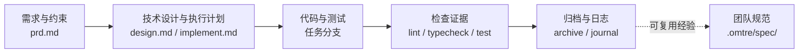

# 认识 omtre

<MaturityBadge level="stable" />

omtre 是一套**面向 AI 编码代理的仓库内工作流框架（workflow harness）**。它不提供模型，也不替代你的编辑器，而是把项目规范、任务上下文、检查证据和跨会话记忆放进 Git 仓库，让 Agent 每次进入项目时都从同一份事实开始。

一句话概括：

> 把“这次要做什么、应该怎么做、做过什么”从聊天记录搬回仓库。

## 它解决什么问题

AI 编码代理通常不缺生成代码的能力，真正容易丢失的是项目上下文：

- 新会话不知道上次为什么这样设计；
- 同一团队用不同 Agent，隐式约定各写各的；
- 需求、实现和验证散落在多个会话里；
- 代码改完后，没有可复查的计划和验证证据；
- 一个重要 bug 修完了，但导致它的原因没有留下。

omtre 的处理方式不是让 Agent “记住更多”，而是让信息落到可提交、可审查的文件中：

| 你想保留的内容 | omtre 中的位置 |
|---|---|
| 团队规范、领域规则、质量要求 | `.omtre/spec/` |
| 本次需求、设计、执行计划和上下文 | `.omtre/tasks/` |
| 每个开发者做过什么、上次停在哪 | `.omtre/workspace/` |
| 实现、检查、研究各自的角色边界 | `.omtre/agents/` |
| 任务状态、验证、归档、会话记录 | `.omtre/scripts/` 与任务文件 |

## 一次任务留下什么

这几类内容分别回答不同问题：

- **PRD**：为什么做、做什么、什么不做；
- **设计**：边界、数据流、兼容性和回滚方式；
- **执行计划**：按什么顺序做、怎么验证；
- **代码与测试**：实际发生了什么；
- **日志与规范**：下次如何少走弯路。

## omtre 是什么，不是什么

| omtre 是 | omtre 不是 |
|---|---|
| 仓库内的工作流与知识结构 | 新的 AI 模型或代码生成服务 |
| 对多种编码代理的平台适配层 | 保证 22 个平台行为完全一致的抽象层 |
| 一套可被 Agent 读取的规范和任务协议 | 不可绕过的安全沙箱 |
| 任务、验证、归档的自动化脚本集合 | 自动提交、自动合并、自动发布的交付系统 |
| 让约定和证据进入 Code Review 的工具 | 替代人做技术判断的评审者 |

::: warning 关键边界
omtre 能把一些动作变成机械闸门，例如“验证命令失败时拒绝归档”。但“先写计划”“只改相关文件”“不要跳过 Review”等规则，多数仍依赖 Agent 遵循工作流和人的检查。不要把提示词约束当成安全控制。
:::

## 它和单独的规则文件有什么不同

`AGENTS.md`、`CLAUDE.md` 或 `.cursorrules` 适合保存一组长期规则。omtre 在这些入口之外增加了任务和证据层：

| 对比项 | 单一规则文件 | omtre |
|---|---|---|
| 规范如何进入会话 | 通常整份加载 | 通过规范索引、任务上下文和平台注入路径加载 |
| 本次任务边界 | 容易只存在聊天中 | `prd.md`、`design.md`、`implement.md` |
| 跨会话记忆 | 依赖代理自身或人工整理 | 开发者 workspace 与 journal |
| 检查证据 | 由当前会话报告 | 任务可记录验证命令并在归档时重放 |
| 多代理协作 | 每个平台各配一份 | 共用 `.omtre/` 核心，平台文件作为适配层 |

这并不意味着 omtre 一定更适合所有项目。小脚本、一次性实验或没有固定协作方式的仓库，继续使用一个清晰的 `AGENTS.md` 可能更划算。

## 适合开始试用的场景

- 已有真实代码库，但关键约定主要存在于资深成员经验里；
- 多人使用不同 AI 编码工具，需要共享同一套项目上下文；
- 需求经常跨多个文件或层次，需要留下计划和检查证据；
- 团队愿意维护 Markdown 规范与任务产物，而不是只追求“一键生成”；
- 你希望切换模型或编辑器时，项目知识仍然留在仓库里。

以下情况应先解决问题，而不是引入更多流程：

- 仓库本身没有可运行的 lint、类型检查或测试命令；
- 团队没有代码评审和提交边界；
- 首个试点必须修改鉴权、支付、数据迁移或生产配置；
- 期望 omtre 自动判断需求正确性并无人值守上线。

## 核心概念

| 概念 | 你可以怎么理解 |
|---|---|
| 规范（spec） | Agent 写代码前要读的项目规则 |
| 任务（task） | 一次可计划、实现、检查和归档的工作单元 |
| 技能（skill） | 宿主按意图加载的一段工作流指令 |
| 子代理（sub-agent） | 主会话派出去做研究、实现或检查的独立 Agent |
| 检查（check） | 对照规范审查改动，并运行真实验证命令 |
| 项目记忆（workspace） | 开发者日志和跨会话线索 |
| 写入者（writer） | 记录是谁发起了本次工作，用于日志和任务归属 |

## 下一步

你已经知道 omtre 的定位。接下来不要先配置一整库规范，而是完成一个真实任务：

- [安装与第一个任务](./install-and-first-task.md)：完成一次安全、可验证的业务小改动。
- [工作原理](./how-it-works.md)：先了解任务执行时到底发生了什么。
